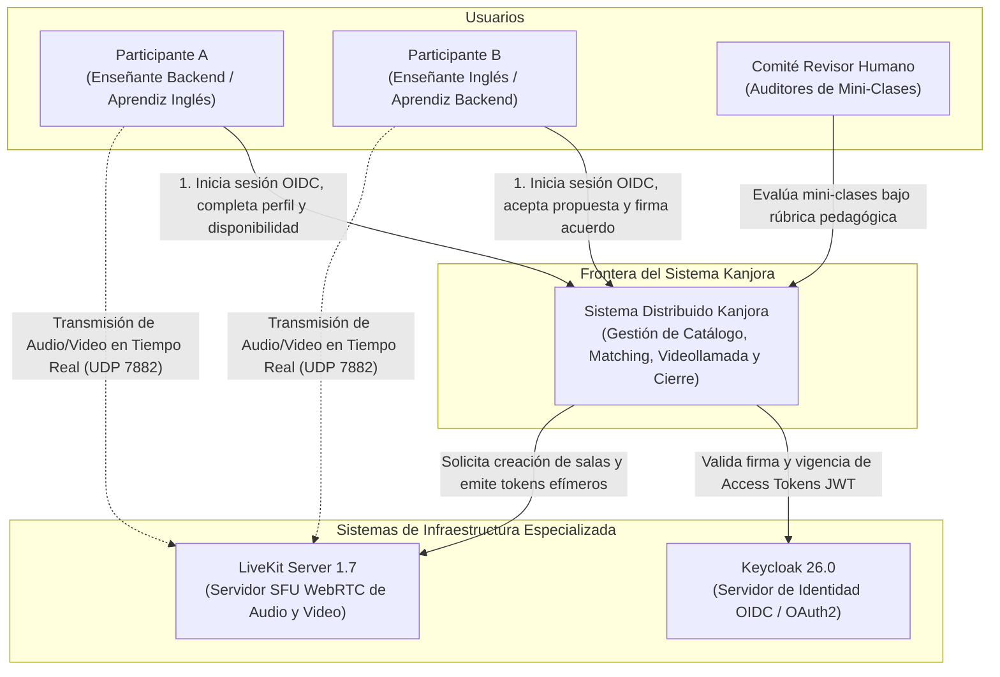
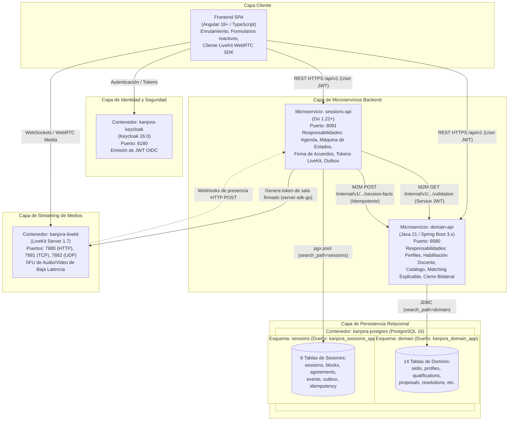
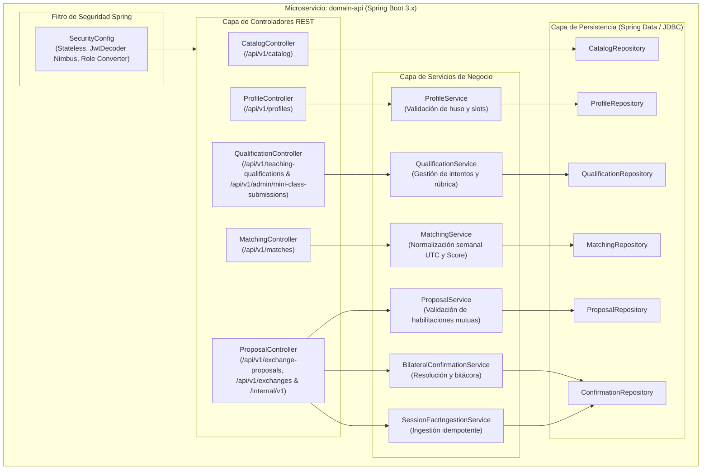
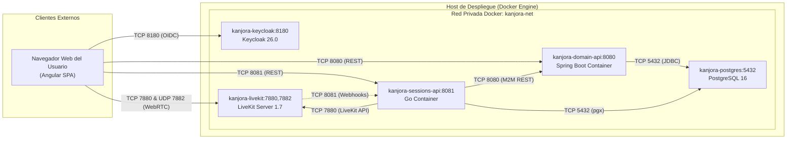

# Kanjora — Documento 01: Visión del Producto y Arquitectura de Software
**Plataforma Distribuida de Trueque y Aprendizaje Recíproco 1:1**

---

## 1. Visión del Producto y Análisis de Negocio

### 1.1 El Problema de Mercado
En el ámbito del aprendizaje de tecnología e idiomas para ingeniería, las soluciones convencionales presentan fallas estructurales:
* **Cursos grabados pasivos:** Altas tasas de abandono (>90%) por carecer de interactividad humana y retroalimentación adaptativa.
* **Tutorías privadas pagadas:** Barrera económica elevada ($30–$80 USD/hora), excluyendo a desarrolladores talentosos de regiones en desarrollo.
* **Plataformas de intercambio asimétricas / Pay-to-Win:** Modelos basados en créditos comerciales donde los usuarios con mayor capacidad económica compran la atención de los mejores docentes, desvirtuando el intercambio colaborativo.

### 1.2 La Propuesta de Valor de Kanjora
**Kanjora** democratiza el acceso al conocimiento técnico avanzado mediante el **trueque directo 1 a 1**:
1. **Reciprocidad Obligatoria:** Toda persona que recibe mentoría en una habilidad debe ofrecer mentoría en otra que domine.
2. **Piloto Estratégico de Lanzamiento:** **Programación Backend $\leftrightarrow$ Inglés Técnico**. Un programador sénior hispanohablante ayuda a un colega a diseñar arquitecturas de microservicios o modelar bases de datos, y a cambio recibe práctica guiada de conversación en inglés para entrevistas y reuniones técnicas.
3. **Cero Especulación Financiera:** Los créditos recompensan la constancia y desbloquean personalización de rutas en fases posteriores; **nunca compran clases ni alteran el orden de búsqueda**.

---

## 2. Decisiones y Trade-offs de Arquitectura (ADR)

| Decisión Arquitectónica | Alternativa Descartada | Justificación Técnica del Trade-off |
| :--- | :--- | :--- |
| **Microservicios Políglotas (Java 21 + Go)** | Monolito único en un solo lenguaje | Java (Spring Boot) ofrece robustez en modelado de dominio DDD, validaciones complejas de catálogo y seguridad corporativa OIDC. Go provee huella de memoria mínima (~25 MB), alta concurrencia nativa (goroutines) y latencia ultra baja para la orquestación de sockets y tokens WebRTC. |
| **Aislamiento Lógico Multi-Schema en PostgreSQL** | Una base de datos física por microservicio | En etapa de MVP, una única instancia PostgreSQL 16 con esquemas segregados (`domain` y `sessions`) y roles independientes (`kanjora_domain_app`, `kanjora_sessions_app`) reduce costos operativos y complejidad de infraestructura al 50%, manteniendo la independencia arquitectónica sin cross-schema queries. |
| **LiveKit SFU (Selective Forwarding Unit)** | WebRTC Mesh peer-to-peer puro | El modelo Mesh satura el ancho de banda de subida del cliente al requerir $N-1$ streams salientes. Un SFU centralizado (LiveKit) reduce el consumo de red en los participantes y garantiza telemetría precisa de caídas y desconexiones mediante webhooks. |
| **Transaccional Outbox HTTP entre Servicios** | Message Broker distribuido (Kafka/RabbitMQ) | Introducir Kafka o RabbitMQ en la fase piloto agregaría sobrecarga operacional innecesaria (Zookeeper/KRaft, clustering, monitoreo). La tabla `session_outbox_facts` con un worker asíncrono en Go y cabecera `Idempotency-Key` en Java ofrece semántica *At-Least-Once Delivery* sin componentes extra. |
| **OpenID Connect Centralizado (Keycloak)** | Sistema propio de autenticación con tablas `users` y passwords | Elimina el riesgo crítico de seguridad asociado al almacenamiento y hashing de credenciales. Permite SSO, rotación automática de claves RSA y compatibilidad nativa con tokens JWT estándar (RFC 7519). |

---

## 3. Diagramas Arquitectónicos C4

### 3.1 Nivel 1: Diagrama de Contexto del Sistema

### 3.2 Nivel 2: Diagrama de Contenedores

### 3.3 Nivel 3: Diagrama de Componentes Internos de Domain API

---

## 4. Diagrama de Despliegue Físico y Redes

