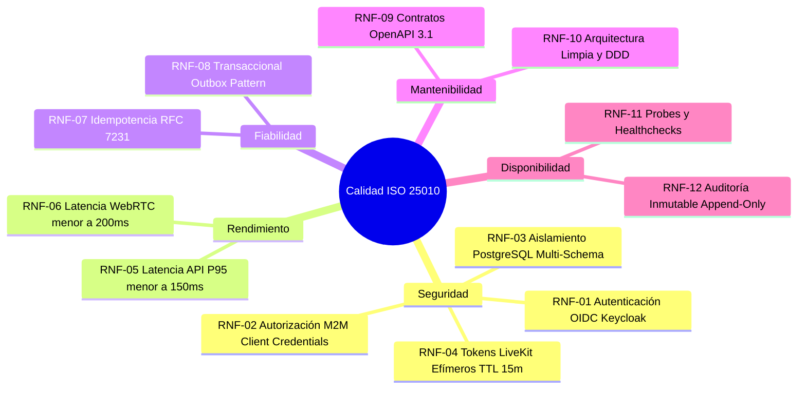

# Kanjora — Documento 02: Especificación de Requisitos y Matriz de Trazabilidad (SRS & RTM)
**Estándar IEEE 830 / ISO/IEC 25010**

---

## 1. Requisitos Funcionales Detallados (RF)

### RF-01: Catálogo Dinámico y Configurable de Conocimiento
* **Módulo:** Catálogo y Contenidos.
* **Entrada:** Petición HTTP `GET /api/v1/catalog/skills`.
* **Procesamiento:** Consulta las categorías activas, habilidades asociadas y sus niveles ordenados jerárquicamente por `rank_order`, junto con los temas específicos (`skill_topics`).
* **Salida:** JSON estructurado `List<CatalogSkillResponse>`.
* **Reglas de Negocio:**
  * No se permite codificar categorías o habilidades en enumeraciones fijas del backend; deben ser leídas desde base de datos.
  * Solo se exponen entidades con bandera `is_active = TRUE`.

---

### RF-05 al RF-08: Ciclo Completo de Habilitación Docente y Calificación Humana
* **Módulo:** Habilitación y Certificación Docente.
* **Precondición:** El usuario debe tener su perfil y zona horaria creados.
* **Flujo BDD / Gherkin:**
```gherkin
Escenario: Candidato postula para enseñar Programación Backend Intermedio
  Dado que el usuario "usr_123" tiene perfil activo en Kanjora
  Cuando envía POST /api/v1/teaching-qualifications con:
    | skill_id | level_id | methodology_acknowledged | practical_test_passed | practical_test_reference |
    | backend  | inter    | true                     | true                  | "github.com/repo/pr"     |
  Entonces el sistema responde 201 Created
  Y el estado de la habilitación es "IN_PROGRESS"

Escenario: Candidato entrega su mini-clase demostrativa
  Dado que existe la habilitación en estado "IN_PROGRESS"
  Cuando envía POST /api/v1/teaching-qualifications/{id}/mini-class con:
    | lesson_objective                         | recording_url        | self_check_summary          |
    | "Diseñar endpoints REST con RFC 9457"    | "https://video.link" | "Cumplí los 4 pasos guía"   |
  Entonces se crea un registro en mini_class_submissions con attempt_number = 1
  Y el estado de la habilitación transiciona a "PENDING_HUMAN_REVIEW"

Escenario: Revisor humano aprueba la mini-clase
  Dado que un usuario con rol "ROLE_REVIEWER" evalúa la entrega
  Cuando envía POST /api/v1/admin/mini-class-submissions/{submissionId}/review con:
    | decision | comments                                              |
    | APPROVED | "Excelente manejo pedagógico del ejercicio práctico"   |
  Entonces la entrega pasa a "APPROVED"
  Y la habilitación pasa a "APPROVED" con approved_at = NOW()
  Y el usuario queda disponible en el pool de matching como enseñante válido
```

---

### RF-09: Algoritmo de Emparejamiento Recíproco Explicable
* **Módulo:** Motor de Matching.
* **Entrada:** `GET /api/v1/matches` (identidad extraída del JWT del usuario solicitante $U_A$).
* **Procesamiento Matemático y Lógico:**
  1. Verificar precondiciones: $U_A$ debe tener al menos una meta de aprendizaje, al menos una habilitación `APPROVED` y al menos un slot horario.
  2. Búsqueda en SQL de candidatos recíprocos $U_B$:
     $$\text{Aprende}(U_A) \cap \text{Enseña}(U_B) \neq \emptyset \quad \land \quad \text{Aprende}(U_B) \cap \text{Enseña}(U_A) \neq \emptyset$$
  3. Conversión de horarios locales a minutos continuos semanales UTC ($0$ a $10079$):
     $$\text{Minutos UTC} = \text{floorMod}(\text{InicioLocal} - \text{OffsetZona}, 10080)$$
  4. Cálculo del tiempo de coincidencia semanal:
     $$\text{Overlap}_{\text{semanal}} = \sum (\text{Slot}_A \cap \text{Slot}_B)$$
  5. Filtro de corte: Si $\text{Overlap}_{\text{semanal}} < 30 \text{ minutos}$, el candidato es descartado.
  6. Cálculo del score de afinidad:
     $$\text{Score} = \text{Overlap}_{\text{semanal}} + (\text{TemasComunes} \times 60.0)$$
* **Salida:** Lista ordenada de candidatos junto con el objeto de explicación transparente (`MatchExplanation`).

---

### RF-13 y RF-14: Agendamiento, Estructura de Bloques y Firma del Acuerdo
* **Módulo:** Orquestación de Sesiones (Sessions API).
* **Entrada:** `POST /api/v1/sessions` con cabecera `Idempotency-Key`.
* **Reglas de Negocio:**
  * La sesión debe agendarse en fecha/hora futura (`scheduled_start_at > NOW()`).
  * Debe contener exactamente **dos bloques pedagógicos balanceados** (`block_order = 1` y `block_order = 2`), donde en uno $U_A$ enseña y $U_B$ aprende, y en el otro $U_B$ enseña y $U_A$ aprende. Duración permitida por bloque: entre 10 y 90 minutos.
  * La sesión inicia en estado `AWAITING_PARTNER_AGREEMENT`.
  * La sesión únicamente transiciona a `SCHEDULED` cuando ambos usuarios envían su aceptación en `session_agreements`.

---

### RF-17 y RF-18: Outbox Idempotente y Cierre Bilateral con Bitácora Inmutable
* **Módulo:** Cierre y Auditoría.
* **Reglas de Negocio:**
  * Al concluir la videollamada, Sessions API almacena el reporte en `session_outbox_facts`.
  * El worker envía `POST /internal/v1/exchanges/{proposalId}/session-facts` con el UUID como `Idempotency-Key`.
  * Domain API registra el informe en `session_fact_reports` e inicializa la resolución. Si el endpoint recibe una petición duplicada con la misma clave, devuelve `200 OK` de forma idempotente sin duplicar registros.
  * Ambos usuarios emiten su voto de confirmación (`PUT /confirmations/me`):
    * Si ambos declaran `outcome = 'COMPLETED'` y `bothBlocksExecuted = true`, la resolución es `CONFIRMED` y se persiste un registro inmutable en `confirmed_exchange_facts_log`.
    * Si uno o ambos reportan incidentes (`PARTNER_NO_SHOW`, `ABANDONED`, `TECHNICAL_ISSUE`), la resolución pasa a `PENDING_REVIEW` para investigación humana, sin penalizaciones punitivas automáticas.

---

## 2. Requisitos No Funcionales (RNF) — ISO/IEC 25010



### Tabla de Medición y Verificación de RNF

| ID RNF | Característica | Métrica Objetivo | Método de Medición / Verificación |
| :--- | :--- | :--- | :--- |
| **RNF-01** | Confidencialidad / Autenticidad | Validación 100% de tokens RSA256 (`iss`, `aud`, `exp`). | Pruebas de integración con tokens alterados, revocados y expirados devolviendo `401 Unauthorized`. |
| **RNF-02** | Control de Acceso M2M | 0 accesos no autorizados a `/internal/v1/*`. | Pruebas de MockMvc con tokens de usuario final devolviendo `403 Forbidden`. |
| **RNF-03** | Segregación de Datos | 0 privilegios cruzados entre esquemas `domain` y `sessions`. | Pruebas SQL conectando con rol `kanjora_domain_app` e intentando `SELECT` en esquema `sessions` (genera error de permisos). |
| **RNF-04** | Protección de Streaming | TTL estricto $\le 15$ minutos en tokens WebRTC. | Inspección de claims `exp` en tokens firmados por `server-sdk-go`. |
| **RNF-05** | Eficiencia Temporal | Tiempo de respuesta P95 < 150 ms bajo 50 req/s concurrentes. | Pruebas de carga con k6 o Gatling sobre el endpoint de matching. |
| **RNF-06** | Calidad de Servicio Media | Latencia de audio/video < 200 ms. | Estadísticas de RTT extraídas de la telemetría WebRTC del servidor LiveKit. |
| **RNF-07** | Tolerancia a Fallas | Cero registros duplicados ante reintentos de red. | Pruebas enviando 5 peticiones idénticas concurrentes con la misma cabecera `Idempotency-Key`. |
| **RNF-08** | Integridad de Mensajería | 100% de entrega eventual de hechos de sesión. | Test de desconexión temporal de Domain API: el Outbox debe reintentar con backoff hasta confirmar entrega. |
| **RNF-09** | Coherencia de Interfaz | Cero discrepancias entre código y OpenAPI. | Validación de esquema OpenAPI 3.1 con OpenAPI-Generator y Spectral Linter. |
| **RNF-10** | Modularidad | Cohesión alta y bajo acoplamiento por capas. | Verificación de arquitectura con ArchUnit en Java. |
| **RNF-11** | Resiliencia Operativa | Detección de caída de contenedor en $< 10$ segundos. | Verificación de Docker Compose Healthchecks (`interval: 5s`, `timeout: 5s`, `retries: 10`). |
| **RNF-12** | No Repudio / Auditoría | Inmutabilidad de hechos cerrados. | Tabla `confirmed_exchange_facts_log` con permisos exclusivos de `INSERT` y `SELECT`, sin `UPDATE` ni `DELETE`. |

---

## 3. Matriz de Trazabilidad de Requisitos (RTM)

| ID Req | Tipo | Caso de Uso | Módulo / Servicio | Endpoint de Interfaz (OpenAPI) | Tabla BD Afectada | Criterio de Verificación / Sprint |
| :---: | :---: | :---: | :---: | :--- | :--- | :---: |
| **RF-01** | Funcional | CU-01 | Domain API (Java) | `GET /api/v1/catalog/skills` | `skill_categories`, `skills`, `skill_levels`, `skill_topics` | Sprint 1 / Test Unitario Catálogo |
| **RF-02** | Funcional | CU-01 | Domain API (Java) | `GET /api/v1/catalog/skills` | `study_guides` | Sprint 1 / Verificación `is_free=true` |
| **RF-03** | Funcional | CU-01 | Domain API (Java) | `GET/PUT /api/v1/profiles/me` | `user_profiles`, `user_availability_slots` | Sprint 1 / MockMvc Perfil y Horarios |
| **RF-04** | Funcional | CU-01 | Domain API (Java) | `PUT /api/v1/profiles/me` | `user_learning_goals`, `user_teaching_offers` | Sprint 1 / Test Integración FK Compuesta |
| **RF-05** | Funcional | CU-02 | Domain API (Java) | `POST /api/v1/teaching-qualifications` | `teaching_qualifications` | Sprint 2 / Creación trámite `IN_PROGRESS` |
| **RF-06** | Funcional | CU-02 | Domain API (Java) | `POST /api/v1/teaching-qualifications` | `teaching_qualifications` | Sprint 2 / Test validación prueba práctica |
| **RF-07** | Funcional | CU-02 | Domain API (Java) | `POST /teaching-qualifications/{id}/mini-class` | `mini_class_submissions` | Sprint 2 / Test incremento `attempt_number` |
| **RF-08** | Funcional | CU-02 | Domain API (Java) | `POST /admin/mini-class-submissions/{id}/review` | `mini_class_submissions`, `teaching_qualifications` | Sprint 2 / MockMvc Rol REVIEWER y aprobación |
| **RF-09** | Funcional | CU-03 | Domain API (Java) | `GET /api/v1/matches` | `teaching_qualifications`, `user_availability_slots` | Sprint 3 / Test Algoritmo Matching UTC |
| **RF-10** | Funcional | CU-04 | Domain API (Java) | `POST /api/v1/exchange-proposals` | `exchange_proposals`, `teaching_qualifications` | Sprint 3 / Test Validación Doble Aprobación |
| **RF-11** | Funcional | CU-04 | Domain API (Java) | `POST /exchange-proposals/{id}/respond` | `exchange_proposals` | Sprint 3 / Transición estado propuesta |
| **RF-12** | Funcional | CU-05 | Sessions API (Go) | `GET /internal/v1/exchange-proposals/{id}/validation` | `exchange_proposals` (vía Domain API) | Sprint 4 / Test de Contrato M2M |
| **RF-13** | Funcional | CU-05 | Sessions API (Go) | `POST /api/v1/sessions` | `sessions`, `session_blocks`, `idempotency_keys` | Sprint 4 / Test Creación y 2 Bloques |
| **RF-14** | Funcional | CU-05 | Sessions API (Go) | `POST /api/v1/sessions/{id}/agreement` | `session_agreements`, `sessions` | Sprint 4 / Transición a `SCHEDULED` |
| **RF-15** | Funcional | CU-06 | Sessions API (Go) | `POST /api/v1/sessions/{id}/room-token` | `session_attendance_events` (LiveKit) | Sprint 4 / Validación token y TTL de 15 min |
| **RF-16** | Funcional | CU-05 | Sessions API (Go) | `POST /cancel`, `PATCH /reschedule` | `sessions`, `session_agreements` | Sprint 4 / Test cancelación sin penalidad |
| **RF-17** | Funcional | CU-07 | Sessions API $\rightarrow$ Java | `POST /internal/v1/exchanges/{id}/session-facts` | `session_outbox_facts` $\rightarrow$ `session_fact_reports` | Sprint 5 / Test Outbox e Idempotencia HTTP |
| **RF-18** | Funcional | CU-07 | Domain API (Java) | `PUT /exchanges/{id}/confirmations/me` | `exchange_confirmations`, `exchange_resolutions`, `confirmed_exchange_facts_log` | Sprint 5 / Test Cierre Bilateral |
