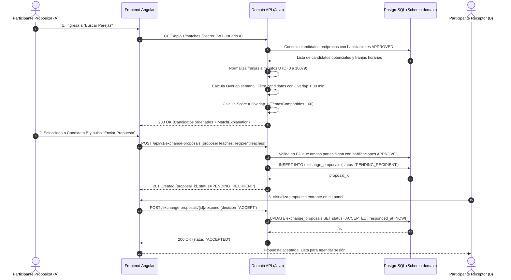
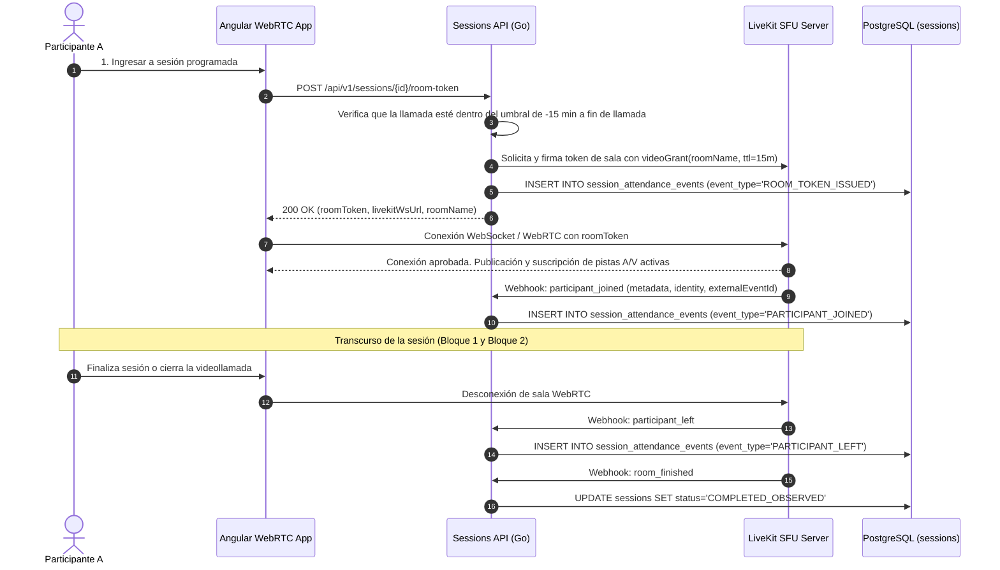

# Kanjora — Documento 03: Especificación de Casos de Uso y Diagramas de Secuencia
**Modelo Formal RUP / Cockburn y Diagramación UML Dinámica**

---

## 1. Diagrama General de Casos de Uso del Sistema

```mermaid
flowchart TD
    subgraph Actores
        ActUser["Participante (Enseñante / Aprendiz)"]
        ActAdmin["Revisor Docente Humano"]
        ActGo["Sessions API (Servicio M2M)"]
        ActLK["Servidor LiveKit WebRTC"]
    end

    subgraph PaquetePerfil ["1. Perfil y Catálogo"]
        CU01["CU-01: Gestionar Perfil, Intereses y Disponibilidad"]
        CU01_1["CU-01.1: Consultar Catálogo y Guías Libres"]
    end

    subgraph PaqueteHabilitacion ["2. Certificación Docente"]
        CU02["CU-02: Solicitar y Certificar Habilitación Docente"]
        CU02_1["CU-02.1: Evaluar y Dictaminar Mini-Clase"]
    end

    subgraph PaqueteMatching ["3. Emparejamiento y Propuestas"]
        CU03["CU-03: Buscar Parejas Recíprocas Explicables"]
        CU04["CU-04: Emitir y Negociar Propuesta de Trueque"]
    end

    subgraph PaqueteSesiones ["4. Orquestación y Videollamada"]
        CU05["CU-05: Agendar Sesión y Firmar Acuerdo"]
        CU06["CU-06: Conectarse a la Videollamada WebRTC"]
    end

    subgraph PaqueteCierre ["5. Hechos y Cierre"]
        CU07["CU-07: Ingestar Hechos y Confirmar Bilateralmente"]
    end

    ActUser --> CU01
    ActUser --> CU01_1
    ActUser --> CU02
    ActUser --> CU03
    ActUser --> CU04
    ActUser --> CU05
    ActUser --> CU06
    ActUser --> CU07

    ActAdmin --> CU02_1
    ActGo --> CU05
    ActGo --> CU07
    ActLK -.->|"Telemetría"| CU06
```

---

## 2. Fichas Técnicas Formales de Casos de Uso (Plantilla RUP / Cockburn)

### CU-01: Gestionar Perfil, Metas de Aprendizaje y Disponibilidad Semanal
* **Actor Primario:** Participante Autenticado.
* **Precondición:** El usuario ha iniciado sesión vía Keycloak OIDC y cuenta con un token JWT válido.
* **Garantía Mínima (Fallo):** Si los datos de disponibilidad son inválidos, el perfil no sufre modificaciones parciales (atomicidad).
* **Garantía de Éxito:** El perfil queda guardado, con zona horaria IANA válida y sus franjas de disponibilidad indexadas.
* **Flujo Principal:**
  1. El usuario accede a la sección "Mi Perfil" en la SPA Angular.
  2. La aplicación invoca `GET /api/v1/profiles/me`. Si el perfil no existe, muestra el asistente de bienvenida.
  3. El usuario completa su nombre visible, biografía corta, zona horaria (ej: `America/Bogota`), sus metas de aprendizaje (`user_learning_goals`), las habilidades que ofrece enseñar (`user_teaching_offers`) y sus franjas de disponibilidad semanal (`user_availability_slots`).
  4. El usuario envía el formulario. La SPA emite `PUT /api/v1/profiles/me`.
  5. El backend valida:
     * Que `end_time_local > start_time_local`.
     * Que `day_of_week` esté comprendido entre 1 (Lunes) y 7 (Domingo).
     * Que la zona horaria corresponda a un `ZoneId` válido en IANA.
  6. El backend persiste los datos en una transacción única en el esquema `domain`.
  7. El sistema retorna `200 OK` con la entidad actualizada.
* **Flujos Alternativos:**
  * **5a. Conflicto de Claves Foráneas:** Si el usuario selecciona un `level_id` que no pertenece al `skill_id`, la base de datos dispara la violación de FK compuesta `FOREIGN KEY (level_id, skill_id)` y el servicio responde `422 Unprocessable Entity` con un `ProblemDetail` normalizado (RFC 9457).

---

### CU-02: Solicitar y Certificar Habilitación Docente (3 Fases)
* **Actor Primario:** Participante con Perfil Activo.
* **Actor Secundario:** Revisor Docente Humano.
* **Precondición:** El usuario no cuenta con habilitación `APPROVED` para la tupla `(skill_id, level_id)` seleccionada.
* **Garantía de Éxito:** La habilitación queda en estado `APPROVED` con marca temporal oficial y habilitada para el matching.
* **Flujo Principal:**
  1. El usuario pulsa "Habilitarme como Docente" para una habilidad (ej: Programación Backend) y nivel (ej: Intermedio).
  2. El sistema presenta la Guía Metodológica de Enseñanza Recíproca en 4 pasos (*1. Objetivo claro, 2. Explicación concreta, 3. Práctica guiada, 4. Comprobación*).
  3. El usuario confirma la lectura de la guía (`methodology_acknowledged = true`) y consigna la evidencia de su prueba práctica técnica aprobada (`practical_test_passed = true`).
  4. La SPA emite `POST /api/v1/teaching-qualifications`. El backend crea el registro en `teaching_qualifications` en estado `IN_PROGRESS` (retorna `201 Created`).
  5. El usuario graba una mini-clase de 15 minutos aplicando la metodología y la aloja en un repositorio o enlace público.
  6. El usuario envía la mini-clase completando objetivo, enlace del entregable y su auto-evaluación (`POST /teaching-qualifications/{id}/mini-class`).
  7. El sistema crea un registro en `mini_class_submissions` con `attempt_number = 1`, estado `PENDING_REVIEW` y actualiza la habilitación a `PENDING_HUMAN_REVIEW`.
  8. El Revisor Humano accede a la consola de administración, revisa el artefacto y califica la entrega como `APPROVED` ingresando observaciones constructivas (`POST /admin/mini-class-submissions/{id}/review`).
  9. El sistema actualiza `mini_class_submissions.review_status = 'APPROVED'`, `teaching_qualifications.status = 'APPROVED'` y establece `approved_at = NOW()`.
* **Flujos de Excepción:**
  * **8a. Desaprobación con Oportunidad de Mejora:** El revisor califica como `REJECTED` e incluye feedback detallado. La habilitación transiciona a `REJECTED`. El participante visualiza las observaciones y queda facultado para emitir una nueva entrega (`attempt_number = 2`) sin ser penalizado ni bloqueado de la plataforma.

---

### CU-03: Buscar Parejas Recíprocas Explicables
* **Actor Primario:** Participante Habilitado.
* **Precondición:** El usuario posee al menos una meta de aprendizaje, al menos una habilitación `APPROVED` y slots de disponibilidad definidos.
* **Garantía de Éxito:** Retorna un listado ordenado transparentemente con la justificación matemática de cada coincidencia.
* **Flujo Principal:**
  1. El usuario pulsa "Buscar Parejas de Intercambio" en la SPA (`GET /api/v1/matches`).
  2. El servicio `MatchingService` recupera el contexto del usuario y consulta en la BD las parejas potenciales donde exista reciprocidad estricta.
  3. Para cada pareja potencial, el motor normaliza los slots semanales a UTC ($0$ a $10079$) y calcula los minutos de coincidencia común.
  4. Si los minutos comunes son $\ge 30$, se calcula la afinidad:
     $$\text{Score} = \text{MinutosComunes} + (\text{TemasAfines} \times 60.0)$$
  5. Se construye el resumen explicativo `MatchExplanation` para cada candidato.
  6. El sistema devuelve la lista ordenada descendentemente por score.
* **Flujos Alternativos:**
  * **2a. Inexistencia de Parejas Válidas:** Si ningún candidato cumple con la coincidencia recíproca o la ventana horaria mínima, el sistema devuelve `hasValidMatches: false` con el mensaje: *"Aún no hay parejas con coincidencia recíproca válida y disponibilidad común. Tu búsqueda sigue activa."* El sistema **nunca** inventa falsas coincidencias ni promueve usuarios por pago.

---

### CU-04: Emitir y Negociar Propuesta de Intercambio
* **Actores:** Participante Propositor ($U_A$), Participante Receptor ($U_B$).
* **Precondición:** Ambos participantes son compatibles según los resultados del matching recíproco.
* **Flujo Principal:**
  1. $U_A$ selecciona al candidato $U_B$ y define las habilidades/niveles que cada uno enseñará, emitiendo `POST /api/v1/exchange-proposals`.
  2. El sistema valida en BD que tanto $U_A$ como $U_B$ posean habilitaciones `APPROVED` para las materias comprometidas y crea la propuesta en estado `PENDING_RECIPIENT`.
  3. $U_B$ recibe la notificación y revisa los detalles pedagógicos propuestos.
  4. $U_B$ acepta la propuesta mediante `POST /exchange-proposals/{proposalId}/respond` con `decision: ACCEPT`.
  5. La propuesta transiciona a `ACCEPTED`. La respuesta incluye las credenciales lógicas para proceder al agendamiento en el servicio de sesiones.
* **Flujo Alternativo:**
  * **4a. Rechazo Respetuoso:** $U_B$ pulsa rechazar e introduce un motivo (`decision: REJECT`). La propuesta pasa a `REJECTED`, notificando a $U_A$ de forma transparente.

---

### CU-05: Agendar Sesión y Firmar Acuerdo Bilateral
* **Actores:** Participante A, Participante B, API de Sesiones (Go), API de Dominio (Java).
* **Precondición:** Existe una propuesta en estado `ACCEPTED`.
* **Flujo Principal:**
  1. El Participante A define la fecha/hora de la llamada y la duración de los 2 bloques de enseñanza (ej: 30 min Backend y 30 min Inglés), enviando `POST /api/v1/sessions` junto a una cabecera `Idempotency-Key`.
  2. Sessions API (Go) ejecuta una petición M2M autenticada hacia Domain API (Java):
     `GET /internal/v1/exchange-proposals/{id}/validation`.
  3. Domain API valida que la propuesta esté `ACCEPTED` y que las habilitaciones docentes permanezcan activas, respondiendo `200 OK`.
  4. Sessions API registra la sesión en `sessions` en estado `AWAITING_PARTNER_AGREEMENT`, divide la estructura en `session_blocks` y guarda la firma del acuerdo del Participante A en `session_agreements`.
  5. El Participante B accede a la sesión, lee el acuerdo de puntualidad y metodología y lo acepta formalmente (`POST /sessions/{id}/agreement`).
  6. Sessions API detecta que ambos participantes han firmado y actualiza la sesión a `SCHEDULED`.

---

### CU-06: Conectarse a la Videollamada WebRTC
* **Actores:** Participante Autorizado, Sessions API (Go), Servidor LiveKit SFU.
* **Precondición:** La sesión se encuentra en estado `SCHEDULED` y faltan $\le 15$ minutos para la hora pactada.
* **Flujo Principal:**
  1. El participante pulsa "Entrar a la Sala" en la interfaz de Kanjora.
  2. La SPA envía `POST /api/v1/sessions/{id}/room-token`.
  3. Sessions API comprueba:
     * Que el usuario forma parte de la sesión (`participant_a_user_id` o `participant_b_user_id`).
     * Que la hora actual se encuentre dentro de la ventana autorizada (desde 15 min antes hasta el fin de la sesión).
  4. Sessions API invoca el SDK oficial de LiveKit en Go, generando un token JWT de sala con TTL de 15 minutos y permisos específicos de publicación y suscripción para la sala `livekit_room_name`.
  5. La SPA recibe el token y se conecta vía WebSocket seguro (`wss://...`) al SFU de LiveKit.
  6. Se inicia la transmisión interactiva de audio y video. LiveKit notifica eventos de presencia (`PARTICIPANT_JOINED`, `PARTICIPANT_LEFT`) hacia Sessions API mediante webhooks HTTP.
* **Flujo de Excepción:**
  * **3a. Intento de Acceso por Tercero:** Si un usuario ajeno intenta solicitar el token de sala, Sessions API responde `403 Forbidden` (`NOT_A_PARTICIPANT`).

---

### CU-07: Ingestar Hechos de Sesión y Confirmar Bilateralmente
* **Actores:** Participante A, Participante B, Sessions API (Go), Domain API (Java).
* **Precondición:** La videollamada ha concluido o expiró el horario programado.
* **Flujo Principal:**
  1. Sessions API evalúa los eventos de presencia recopilados y escribe el hecho terminal (`COMPLETED_OBSERVED`, `NO_SHOW_OBSERVED`, etc.) en `session_outbox_facts`.
  2. El despachador Outbox de Go realiza un `POST /internal/v1/exchanges/{id}/session-facts` enviando la clave de idempotencia única.
  3. Domain API registra el hecho en `session_fact_reports` e inicializa `exchange_resolutions` en `AWAITING_BILATERAL_CONFIRMATION`.
  4. Los participantes A y B acceden individualmente a la pantalla de cierre y emiten su declaración (`PUT /exchanges/{id}/confirmations/me`).
  5. Si ambos declaran que la sesión fue exitosa (`COMPLETED`) y que ambos bloques se ejecutaron, la resolución pasa a `CONFIRMED` y se genera un registro inmutable en `confirmed_exchange_facts_log`.
* **Flujo Alternativo:**
  * **5a. Discrepancia o Falla Técnica:** Si un participante reporta un problema (`INCOMPLETE_TECHNICAL_ISSUE` o `PARTNER_NO_SHOW`), el sistema clasifica la resolución como `PENDING_REVIEW` para investigación humana, garantizando que ninguna falla técnica de red sea castigada injustamente como abandono voluntario.

---

## 3. Diagramas de Secuencia Detallados

### 3.1 Diagrama: Algoritmo de Matching y Creación de Propuesta

### 3.2 Diagrama: Ciclo de Videollamada WebRTC y Eventos de Presencia

