# Kanjora — Documento 04: Modelo Entidad-Relación y Diccionario de Datos Completo
**Arquitectura de Datos Multi-Schema en PostgreSQL 16 (Esquemas `domain` y `sessions`)**

---

## 1. Principios de Diseño del Modelo Relacional

El modelo de datos de Kanjora ha sido concebido bajo los más rigurosos estándares de la teoría de bases de datos relacionales:
1. **Normalización Estricta (3FN/BCNF):** Eliminación total de anomalías de inserción, actualización y borrado. Las relaciones $M:N$ (ej. intereses de usuario en temas o bloques de sesión) se encuentran desacopladas en tablas asociativas formales.
2. **Integridad Referencial Compuesta:** Empleo de claves compuestas en cascada para impedir inconsistencias jerárquicas; por ejemplo, una meta de aprendizaje valida simultáneamente `FOREIGN KEY (target_level_id, skill_id) REFERENCES skill_levels(level_id, skill_id)`.
3. **Restricciones Semánticas en Motor (`CHECK` Constraints):** Las reglas críticas de negocio no descansan únicamente en la capa de aplicación, sino que se hacen cumplir a nivel del motor de base de datos (ej. horarios válidos, duraciones de bloques de 10 a 90 min, exactamente dos bloques de sesión, y validaciones de no-autoemparejamiento).
4. **Índices Parciales Optimizados:** Para acelerar consultas críticas sin inflar el tamaño de los índices en disco, se utilizan índices condicionales como `WHERE is_active = TRUE` o `WHERE status = 'APPROVED'`.

---

## 2. Diagrama Entidad-Relación Físico (Mermaid ERD)

```mermaid
erDiagram
    %% ==========================================
    %% ESQUEMA DOMAIN
    %% ==========================================
    SKILL_CATEGORIES ||--o{ SKILLS : "1:N (agrupa)"
    SKILLS ||--o{ SKILL_LEVELS : "1:N (estratifica)"
    SKILLS ||--o{ SKILL_TOPICS : "1:N (desglosa)"
    SKILLS ||--o{ STUDY_GUIDES : "1:N (orienta)"
    USER_PROFILES ||--o{ USER_AVAILABILITY_SLOTS : "1:N (dispone)"
    USER_PROFILES ||--o{ USER_LEARNING_GOALS : "1:N (aprende)"
    USER_LEARNING_GOALS ||--o{ USER_LEARNING_GOAL_TOPICS : "1:N (especifica)"
    USER_PROFILES ||--o{ USER_TEACHING_OFFERS : "1:N (ofrece)"
    USER_TEACHING_OFFERS ||--o{ USER_TEACHING_OFFER_TOPICS : "1:N (especifica)"
    USER_PROFILES ||--o{ TEACHING_QUALIFICATIONS : "1:N (certifica)"
    TEACHING_QUALIFICATIONS ||--o{ MINI_CLASS_SUBMISSIONS : "1:N (evalúa)"
    USER_PROFILES ||--o{ EXCHANGE_PROPOSALS : "1:N (propone/recibe)"
    EXCHANGE_PROPOSALS ||--o{ SESSION_FACT_REPORTS : "1:N (reporta)"
    EXCHANGE_PROPOSALS ||--|| EXCHANGE_RESOLUTIONS : "1:1 (resuelve)"
    EXCHANGE_PROPOSALS ||--o{ EXCHANGE_CONFIRMATIONS : "1:2 (vota)"
    EXCHANGE_PROPOSALS ||--o| CONFIRMED_EXCHANGE_FACTS_LOG : "1:1 (audita)"

    %% ==========================================
    %% ESQUEMA SESSIONS
    %% ==========================================
    SESSIONS ||--o{ SESSION_BLOCKS : "1:2 (estructura)"
    SESSIONS ||--o{ SESSION_AGREEMENTS : "1:2 (firma)"
    SESSIONS ||--o{ SESSION_ATTENDANCE_EVENTS : "1:N (telemetría)"
    SESSIONS ||--o{ SESSION_OUTBOX_FACTS : "1:N (despacha)"

    SKILL_CATEGORIES {
        uuid category_id PK
        varchar slug UK
        varchar name
        boolean is_active
        timestamptz created_at
    }

    SKILLS {
        uuid skill_id PK
        uuid category_id FK
        varchar slug UK
        varchar name
        text description
        boolean is_active
        timestamptz created_at
    }

    SKILL_LEVELS {
        uuid level_id PK
        uuid skill_id FK
        varchar code
        varchar name
        smallint rank_order
        boolean is_active
    }

    SKILL_TOPICS {
        uuid topic_id PK
        uuid skill_id FK
        varchar code
        varchar name
        boolean is_active
    }

    STUDY_GUIDES {
        uuid guide_id PK
        uuid skill_id FK
        uuid level_id FK
        varchar guide_type
        varchar title
        text content_markdown
        boolean is_free
        boolean is_active
        timestamptz created_at
    }

    USER_PROFILES {
        varchar user_id PK "OIDC sub"
        varchar display_name
        varchar bio
        varchar timezone
        boolean is_active
        timestamptz created_at
        timestamptz updated_at
    }

    USER_AVAILABILITY_SLOTS {
        uuid slot_id PK
        varchar user_id FK
        smallint day_of_week
        time start_time_local
        time end_time_local
    }

    USER_LEARNING_GOALS {
        uuid goal_id PK
        varchar user_id FK
        uuid skill_id FK
        uuid target_level_id FK
        timestamptz created_at
    }

    USER_LEARNING_GOAL_TOPICS {
        uuid goal_id PK, FK
        uuid topic_id PK, FK
        uuid skill_id FK
    }

    USER_TEACHING_OFFERS {
        uuid offer_id PK
        varchar user_id FK
        uuid skill_id FK
        uuid level_id FK
        timestamptz created_at
    }

    USER_TEACHING_OFFER_TOPICS {
        uuid offer_id PK, FK
        uuid topic_id PK, FK
        uuid skill_id FK
    }

    TEACHING_QUALIFICATIONS {
        uuid qualification_id PK
        varchar user_id FK
        uuid skill_id FK
        uuid level_id FK
        varchar status
        boolean methodology_acknowledged
        boolean practical_test_passed
        varchar practical_test_reference
        timestamptz approved_at
        timestamptz created_at
        timestamptz updated_at
    }

    MINI_CLASS_SUBMISSIONS {
        uuid submission_id PK
        uuid qualification_id FK
        int attempt_number
        varchar lesson_objective
        text recording_or_artifact_url
        varchar self_check_summary
        varchar review_status
        varchar reviewer_user_id
        varchar reviewer_comments
        timestamptz submitted_at
        timestamptz reviewed_at
    }

    EXCHANGE_PROPOSALS {
        uuid proposal_id PK
        varchar proposer_user_id FK
        varchar recipient_user_id FK
        uuid proposer_teaches_skill_id FK
        uuid proposer_teaches_level_id FK
        uuid proposer_qualification_id FK
        varchar proposer_topic_code
        uuid recipient_teaches_skill_id FK
        uuid recipient_teaches_level_id FK
        uuid recipient_qualification_id FK
        varchar recipient_topic_code
        varchar status
        numeric match_score
        jsonb match_explanation_json
        varchar rejection_reason
        timestamptz created_at
        timestamptz responded_at
    }

    SESSION_FACT_REPORTS {
        varchar fact_report_id PK
        uuid proposal_id FK
        uuid session_id
        varchar terminal_session_state
        timestamptz occurred_at
        jsonb participants_attendance_json
        boolean technical_incident_observed
        varchar incident_code
        timestamptz received_at
    }

    EXCHANGE_RESOLUTIONS {
        uuid proposal_id PK, FK
        uuid session_id
        varchar resolution_status
        timestamptz updated_at
        timestamptz resolved_at
        varchar reviewer_user_id
        text resolution_notes
    }

    EXCHANGE_CONFIRMATIONS {
        uuid confirmation_id PK
        uuid proposal_id FK
        uuid session_id
        varchar user_id FK
        varchar outcome_declaration
        boolean both_blocks_executed
        varchar learned_skill_progress_note
        varchar incident_reason
        varchar incident_details
        boolean would_repeat_with_partner
        timestamptz confirmed_at
    }

    CONFIRMED_EXCHANGE_FACTS_LOG {
        uuid fact_id PK
        uuid proposal_id UK, FK
        uuid session_id UK
        varchar participant_a_user_id FK
        varchar participant_b_user_id FK
        timestamptz confirmed_at
        jsonb fact_payload_json
    }

    SESSIONS {
        uuid session_id PK
        uuid proposal_id
        varchar participant_a_user_id
        varchar participant_b_user_id
        varchar status
        timestamptz scheduled_start_at
        timestamptz scheduled_end_at
        varchar livekit_room_name UK
        jsonb recommended_guide_ids_json
        varchar cancellation_reason
        varchar cancelled_by_user_id
        boolean technical_or_emergency_flag
        timestamptz created_at
        timestamptz updated_at
    }

    SESSION_BLOCKS {
        uuid block_id PK
        uuid session_id FK
        smallint block_order
        smallint duration_minutes
        varchar teacher_user_id
        varchar learner_user_id
        varchar skill_slug
        varchar topic_code
    }

    SESSION_AGREEMENTS {
        uuid session_id PK, FK
        varchar user_id PK
        varchar agreement_version
        boolean accepted
        timestamptz accepted_at
    }

    SESSION_ATTENDANCE_EVENTS {
        uuid event_id PK
        uuid session_id FK
        varchar user_id
        varchar event_type
        varchar external_event_id UK
        timestamptz occurred_at
        jsonb metadata_json
    }

    SESSION_OUTBOX_FACTS {
        varchar fact_report_id PK
        uuid session_id FK
        uuid proposal_id
        jsonb payload_json
        varchar delivery_status
        int attempt_count
        timestamptz next_retry_at
        int last_http_status
        text last_error
        timestamptz created_at
        timestamptz delivered_at
    }

    IDEMPOTENCY_KEYS {
        varchar idempotency_key PK
        varchar operation_name PK
        varchar actor_user_id PK
        varchar request_hash
        int response_status
        jsonb response_body
        timestamptz created_at
        timestamptz expires_at
    }
```

---

## 3. Diccionario de Datos Exhaustivo

### 3.1 Esquema `domain`

#### 1. Tabla: `skill_categories`
| Campo | Tipo | Nulo | Por Defecto | Restricciones | Descripción |
| :--- | :--- | :---: | :--- | :--- | :--- |
| `category_id` | `UUID` | No | `gen_random_uuid()` | `PRIMARY KEY` | Clave subrogada de la categoría. |
| `slug` | `VARCHAR(64)` | No | | `UNIQUE` | Identificador textual legible (URL-friendly). |
| `name` | `VARCHAR(120)` | No | | | Nombre formal de la categoría. |
| `is_active` | `BOOLEAN` | No | `TRUE` | | Indica si la categoría está disponible en el catálogo. |
| `created_at` | `TIMESTAMPTZ`| No | `NOW()` | | Timestamp de auditoría de creación. |

#### 2. Tabla: `skills`
| Campo | Tipo | Nulo | Por Defecto | Restricciones | Descripción |
| :--- | :--- | :---: | :--- | :--- | :--- |
| `skill_id` | `UUID` | No | `gen_random_uuid()` | `PRIMARY KEY` | Clave primaria de la habilidad técnica. |
| `category_id`| `UUID` | No | | `REFERENCES skill_categories(category_id)` | Categoría a la que pertenece la disciplina. |
| `slug` | `VARCHAR(80)` | No | | `UNIQUE` | Identificador único de la habilidad. |
| `name` | `VARCHAR(140)`| No | | | Título oficial de la habilidad. |
| `description`| `TEXT` | Sí | | | Resumen del enfoque práctico del aprendizaje. |
| `is_active` | `BOOLEAN` | No | `TRUE` | | Estado activo/inactivo. |
| `created_at` | `TIMESTAMPTZ`| No | `NOW()` | | Timestamp de creación. |
* **Índices:** `idx_skills_category_active` en `(category_id) WHERE is_active = TRUE`.

#### 3. Tabla: `skill_levels`
| Campo | Tipo | Nulo | Por Defecto | Restricciones | Descripción |
| :--- | :--- | :---: | :--- | :--- | :--- |
| `level_id` | `UUID` | No | `gen_random_uuid()` | `PRIMARY KEY` | Identificador del nivel de destreza. |
| `skill_id` | `UUID` | No | | `REFERENCES skills(skill_id) ON DELETE CASCADE` | Habilidad asociada. |
| `code` | `VARCHAR(32)` | No | | | Código interno (ej: `'BASICO'`, `'A2'`, `'B1'`). |
| `name` | `VARCHAR(80)` | No | | | Nombre visible para el estudiante. |
| `rank_order` | `SMALLINT` | No | | `CHECK (rank_order >= 1)` | Jerarquía ordinal ascendente. |
| `is_active` | `BOOLEAN` | No | `TRUE` | | Estado de activación del nivel. |
* **Restricciones de Unicidad:** `UNIQUE (skill_id, code)`, `UNIQUE (skill_id, rank_order)`, `UNIQUE (level_id, skill_id)`.

#### 4. Tabla: `skill_topics`
| Campo | Tipo | Nulo | Por Defecto | Restricciones | Descripción |
| :--- | :--- | :---: | :--- | :--- | :--- |
| `topic_id` | `UUID` | No | `gen_random_uuid()` | `PRIMARY KEY` | Identificador del tema. |
| `skill_id` | `UUID` | No | | `REFERENCES skills(skill_id) ON DELETE CASCADE` | Habilidad asociada. |
| `code` | `VARCHAR(64)` | No | | | Slug del tema (ej: `'rest-apis'`). |
| `name` | `VARCHAR(140)`| No | | | Título del tema formativo. |
| `is_active` | `BOOLEAN` | No | `TRUE` | | Bandera de activación. |
* **Restricciones de Unicidad:** `UNIQUE (skill_id, code)`, `UNIQUE (topic_id, skill_id)`.

#### 5. Tabla: `study_guides`
| Campo | Tipo | Nulo | Por Defecto | Restricciones | Descripción |
| :--- | :--- | :---: | :--- | :--- | :--- |
| `guide_id` | `UUID` | No | `gen_random_uuid()` | `PRIMARY KEY` | Identificador de la guía de estudio. |
| `skill_id` | `UUID` | Sí | | `REFERENCES skills(skill_id)` | Habilidad específica o `NULL` si es general. |
| `level_id` | `UUID` | Sí | | `FOREIGN KEY (level_id, skill_id)` | Nivel específico o `NULL`. |
| `guide_type` | `VARCHAR(32)` | No | | `CHECK IN ('METHODOLOGY', 'BASIC_STUDY_ROUTE', 'SESSION_GUIDE')` | Tipo de documento pedagógico. |
| `title` | `VARCHAR(180)`| No | | | Título de la guía. |
| `content_markdown` | `TEXT` | No | | | Contenido pedagógico en formato Markdown. |
| `is_free` | `BOOLEAN` | No | `TRUE` | `CHECK (is_free = TRUE)` | Garantiza gratuidad de guías esenciales. |
| `is_active` | `BOOLEAN` | No | `TRUE` | | Estado de visibilidad. |
| `created_at` | `TIMESTAMPTZ`| No | `NOW()` | | Timestamp de creación. |

#### 6. Tabla: `user_profiles`
| Campo | Tipo | Nulo | Por Defecto | Restricciones | Descripción |
| :--- | :--- | :---: | :--- | :--- | :--- |
| `user_id` | `VARCHAR(128)`| No | | `PRIMARY KEY` | Identificador canónico OIDC (`sub` del JWT). |
| `display_name`| `VARCHAR(80)` | No | | | Nombre público del usuario. |
| `bio` | `VARCHAR(500)`| Sí | | | Biografía breve y contexto profesional. |
| `timezone` | `VARCHAR(64)` | No | | | Huso horario IANA (ej: `'America/Bogota'`). |
| `is_active` | `BOOLEAN` | No | `TRUE` | | Estado operativo de la cuenta. |
| `created_at` | `TIMESTAMPTZ`| No | `NOW()` | | Fecha de registro. |
| `updated_at` | `TIMESTAMPTZ`| No | `NOW()` | | Última modificación de perfil. |

#### 7. Tabla: `user_availability_slots`
| Campo | Tipo | Nulo | Por Defecto | Restricciones | Descripción |
| :--- | :--- | :---: | :--- | :--- | :--- |
| `slot_id` | `UUID` | No | `gen_random_uuid()` | `PRIMARY KEY` | Identificador de la franja horaria. |
| `user_id` | `VARCHAR(128)`| No | | `REFERENCES user_profiles(user_id) ON DELETE CASCADE` | Propietario de la disponibilidad. |
| `day_of_week` | `SMALLINT` | No | | `CHECK (day_of_week BETWEEN 1 AND 7)` | Día de la semana (1 = Lunes, 7 = Domingo). |
| `start_time_local` | `TIME` | No | | | Hora local de inicio del bloque. |
| `end_time_local` | `TIME` | No | | `CHECK (end_time_local > start_time_local)` | Hora local de culminación. |
* **Índices:** `idx_availability_user_day` en `(user_id, day_of_week, start_time_local)`.

#### 8. Tabla: `teaching_qualifications`
| Campo | Tipo | Nulo | Por Defecto | Restricciones | Descripción |
| :--- | :--- | :---: | :--- | :--- | :--- |
| `qualification_id` | `UUID` | No | `gen_random_uuid()` | `PRIMARY KEY` | Identificador del trámite de habilitación. |
| `user_id` | `VARCHAR(128)`| No | | `REFERENCES user_profiles(user_id) ON DELETE CASCADE` | Candidato a enseñante. |
| `skill_id` | `UUID` | No | | `REFERENCES skills(skill_id)` | Materia postulada. |
| `level_id` | `UUID` | No | | `FOREIGN KEY (level_id, skill_id)` | Nivel postulado. |
| `status` | `VARCHAR(32)` | No | | `CHECK IN ('IN_PROGRESS', 'PENDING_HUMAN_REVIEW', 'APPROVED', 'REJECTED', 'REVOKED')` | Estado actual de la certificación. |
| `methodology_acknowledged` | `BOOLEAN` | No | `FALSE` | | Reconocimiento de la metodología Kanjora. |
| `practical_test_passed` | `BOOLEAN` | No | `FALSE` | | Aprobación de la prueba técnica objetiva. |
| `practical_test_reference` | `VARCHAR(255)` | Sí | | | Enlace o comprobante de la prueba técnica. |
| `approved_at` | `TIMESTAMPTZ`| Sí | | | Timestamp de concesión de habilitación. |
| `created_at` | `TIMESTAMPTZ`| No | `NOW()` | | Timestamp de inicio de solicitud. |
| `updated_at` | `TIMESTAMPTZ`| No | `NOW()` | | Última actualización del trámite. |
* **Restricciones Especiales:** `UNIQUE (user_id, skill_id, level_id)`, `CHECK (status <> 'APPROVED' OR (methodology_acknowledged = TRUE AND practical_test_passed = TRUE))`.
* **Índices:** `idx_qualifications_approved_lookup` en `(skill_id, level_id, user_id) WHERE status = 'APPROVED'`.

#### 9. Tabla: `mini_class_submissions`
| Campo | Tipo | Nulo | Por Defecto | Restricciones | Descripción |
| :--- | :--- | :---: | :--- | :--- | :--- |
| `submission_id` | `UUID` | No | `gen_random_uuid()` | `PRIMARY KEY` | Identificador del entregable de mini-clase. |
| `qualification_id` | `UUID` | No | | `REFERENCES teaching_qualifications(qualification_id) ON DELETE CASCADE` | Trámite padre. |
| `attempt_number` | `INT` | No | | `CHECK (attempt_number >= 1)` | Número de intento de entrega. |
| `lesson_objective` | `VARCHAR(500)`| No | | | Objetivo pedagógico estructurado. |
| `recording_or_artifact_url`| `TEXT` | No | | | Enlace al video demostrativo o repositorio. |
| `self_check_summary` | `VARCHAR(1000)`| No | | | Resumen de auto-evaluación del aspirante. |
| `review_status` | `VARCHAR(24)` | No | `'PENDING_REVIEW'` | `CHECK IN ('PENDING_REVIEW', 'APPROVED', 'REJECTED')` | Estado de calificación del intento. |
| `reviewer_user_id` | `VARCHAR(128)`| Sí | | | Revisor humano asignado. |
| `reviewer_comments` | `VARCHAR(2000)`| Sí | | | Feedback técnico y pedagógico obligatorio. |
| `submitted_at` | `TIMESTAMPTZ`| No | `NOW()` | | Timestamp de remisión. |
| `reviewed_at` | `TIMESTAMPTZ`| Sí | | | Timestamp de evaluación formal. |
* **Restricciones de Unicidad:** `UNIQUE (qualification_id, attempt_number)`.
* **Índices Parciales:** `idx_one_pending_submission_per_qual` en `(qualification_id) WHERE review_status = 'PENDING_REVIEW'`.

#### 10. Tabla: `exchange_proposals`
| Campo | Tipo | Nulo | Por Defecto | Restricciones | Descripción |
| :--- | :--- | :---: | :--- | :--- | :--- |
| `proposal_id` | `UUID` | No | `gen_random_uuid()` | `PRIMARY KEY` | Identificador de la propuesta de trueque. |
| `proposer_user_id` | `VARCHAR(128)`| No | | `REFERENCES user_profiles(user_id)` | Usuario que origina la propuesta. |
| `recipient_user_id` | `VARCHAR(128)`| No | | `REFERENCES user_profiles(user_id)` | Usuario que recibe la propuesta. |
| `proposer_teaches_skill_id` | `UUID` | No | | `REFERENCES skills(skill_id)` | Habilidad que enseñará el originador. |
| `proposer_teaches_level_id` | `UUID` | No | | | Nivel que enseñará el originador. |
| `proposer_qualification_id` | `UUID` | No | | `FOREIGN KEY compuesta` | Certificación válida del proponente. |
| `recipient_teaches_skill_id`| `UUID` | No | | `REFERENCES skills(skill_id)` | Habilidad que enseñará el receptor. |
| `recipient_teaches_level_id`| `UUID` | No | | | Nivel que enseñará el receptor. |
| `recipient_qualification_id`| `UUID` | No | | `FOREIGN KEY compuesta` | Certificación válida del receptor. |
| `status` | `VARCHAR(32)` | No | | `CHECK IN ('PENDING_RECIPIENT', 'ACCEPTED', 'REJECTED', 'EXPIRED', 'COMPLETED', 'PENDING_REVIEW')` | Estado operativo de la propuesta. |
| `match_score` | `NUMERIC(8,2)`| No | `0` | | Puntuación algorítmica calculada en el match. |
| `match_explanation_json` | `JSONB` | No | | | Desglose explicativo de la afinidad. |
| `rejection_reason` | `VARCHAR(500)`| Sí | | | Motivo en caso de rechazo. |
| `created_at` | `TIMESTAMPTZ`| No | `NOW()` | | Timestamp de emisión. |
| `responded_at` | `TIMESTAMPTZ`| Sí | | | Timestamp de respuesta del receptor. |
* **Restricciones de Integridad:** `CHECK (proposer_user_id <> recipient_user_id)`.
* **Índices:** `idx_proposals_participants` en `(proposer_user_id, recipient_user_id, status)`.

#### 11. Tabla: `session_fact_reports`
| Campo | Tipo | Nulo | Por Defecto | Restricciones | Descripción |
| :--- | :--- | :---: | :--- | :--- | :--- |
| `fact_report_id` | `VARCHAR(128)`| No | | `PRIMARY KEY` | Clave de idempotencia única proveniente de Go. |
| `proposal_id` | `UUID` | No | | `REFERENCES exchange_proposals(proposal_id)` | Propuesta asociada. |
| `session_id` | `UUID` | No | | | Identificador de la sesión en Sessions API. |
| `terminal_session_state` | `VARCHAR(40)` | No | | `CHECK IN ('COMPLETED_OBSERVED', 'NO_SHOW_OBSERVED', 'ABANDONED_MID_CALL', 'TECHNICAL_FAILURE_OBSERVED', 'CANCELLED_BEFORE_START')` | Estado final observado de la llamada. |
| `occurred_at` | `TIMESTAMPTZ`| No | | | Momento del evento en el servidor de medios. |
| `participants_attendance_json`| `JSONB` | No | | | Trazas detalladas de conexión y desconexión. |
| `technical_incident_observed` | `BOOLEAN` | No | `FALSE` | | Bandera de incidentes de red o caídas. |
| `incident_code` | `VARCHAR(64)` | Sí | | | Código de diagnóstico técnico. |
| `received_at` | `TIMESTAMPTZ`| No | `NOW()` | | Timestamp de ingesta en Java. |

#### 12. Tabla: `exchange_resolutions`
| Campo | Tipo | Nulo | Por Defecto | Restricciones | Descripción |
| :--- | :--- | :---: | :--- | :--- | :--- |
| `proposal_id` | `UUID` | No | | `PRIMARY KEY, REFERENCES exchange_proposals` | Propuesta resuelta. |
| `session_id` | `UUID` | No | | | Sesión asociada. |
| `resolution_status` | `VARCHAR(40)` | No | | `CHECK IN ('AWAITING_BILATERAL_CONFIRMATION', 'AWAITING_PARTNER_CONFIRMATION', 'CONFIRMED', 'PENDING_REVIEW', 'CANCELLED_NO_PENALTY')` | Estado unificado del intercambio. |
| `updated_at` | `TIMESTAMPTZ`| No | `NOW()` | | Timestamp de modificación. |
| `resolved_at` | `TIMESTAMPTZ`| Sí | | | Momento de cierre definitivo. |
| `reviewer_user_id` | `VARCHAR(128)`| Sí | | | Moderador asignado en caso de revisión. |
| `resolution_notes` | `TEXT` | Sí | | | Dictamen final emitido. |

#### 13. Tabla: `exchange_confirmations`
| Campo | Tipo | Nulo | Por Defecto | Restricciones | Descripción |
| :--- | :--- | :---: | :--- | :--- | :--- |
| `confirmation_id` | `UUID` | No | `gen_random_uuid()` | `PRIMARY KEY` | Identificador del voto individual. |
| `proposal_id` | `UUID` | No | | `REFERENCES exchange_proposals` | Propuesta evaluada. |
| `session_id` | `UUID` | No | | | Sesión evaluada. |
| `user_id` | `VARCHAR(128)`| No | | `REFERENCES user_profiles(user_id)` | Participante que emite el veredicto. |
| `outcome_declaration`| `VARCHAR(40)` | No | | `CHECK IN ('COMPLETED', 'INCOMPLETE_TECHNICAL_ISSUE', 'PARTNER_NO_SHOW', 'PARTNER_ABANDONED', 'METHODOLOGY_NOT_FOLLOWED')` | Declaración de resultado. |
| `both_blocks_executed`| `BOOLEAN` | No | | | Cumplimiento de ambos bloques. |
| `learned_skill_progress_note`| `VARCHAR(1000)`| Sí | | | Reflexión sobre el aprendizaje obtenido. |
| `would_repeat_with_partner` | `BOOLEAN` | No | | | Índice de afinidad con la pareja. |
| `confirmed_at` | `TIMESTAMPTZ`| No | `NOW()` | | Timestamp de confirmación. |
* **Restricciones de Unicidad:** `UNIQUE (proposal_id, session_id, user_id)`.

#### 14. Tabla: `confirmed_exchange_facts_log`
| Campo | Tipo | Nulo | Por Defecto | Restricciones | Descripción |
| :--- | :--- | :---: | :--- | :--- | :--- |
| `fact_id` | `UUID` | No | `gen_random_uuid()` | `PRIMARY KEY` | Identificador único de auditoría. |
| `proposal_id` | `UUID` | No | | `UNIQUE, REFERENCES exchange_proposals` | Propuesta exitosamente cerrada. |
| `session_id` | `UUID` | No | | `UNIQUE` | Sesión exitosa. |
| `participant_a_user_id`| `VARCHAR(128)`| No | | `REFERENCES user_profiles` | Participante A. |
| `participant_b_user_id`| `VARCHAR(128)`| No | | `REFERENCES user_profiles` | Participante B. |
| `confirmed_at` | `TIMESTAMPTZ`| No | `NOW()` | | Marca temporal inmutable de éxito. |
| `fact_payload_json` | `JSONB` | No | | | Instantánea completa de los hechos del intercambio. |

---

### 3.2 Esquema `sessions`

#### 1. Tabla: `sessions`
| Campo | Tipo | Nulo | Por Defecto | Restricciones | Descripción |
| :--- | :--- | :---: | :--- | :--- | :--- |
| `session_id` | `UUID` | No | `gen_random_uuid()` | `PRIMARY KEY` | Clave primaria de la sesión en Go. |
| `proposal_id` | `UUID` | No | | | Vínculo lógico con la propuesta de dominio. |
| `participant_a_user_id`| `VARCHAR(128)`| No | | | Identificador del participante A. |
| `participant_b_user_id`| `VARCHAR(128)`| No | | | Identificador del participante B. |
| `status` | `VARCHAR(40)` | No | | `CHECK IN ('AWAITING_PARTNER_AGREEMENT', 'SCHEDULED', 'RESCHEDULE_PENDING_ACCEPTANCE', 'IN_PROGRESS', 'COMPLETED_OBSERVED', 'CANCELLED', 'NO_SHOW_OBSERVED', 'TECHNICAL_FAILURE_OBSERVED', 'ABANDONED_MID_CALL')` | Máquina de estados de la llamada. |
| `scheduled_start_at` | `TIMESTAMPTZ`| No | | | Inicio programado. |
| `scheduled_end_at` | `TIMESTAMPTZ`| No | | `CHECK (scheduled_end_at > scheduled_start_at)` | Fin programado. |
| `livekit_room_name` | `VARCHAR(160)`| No | | `UNIQUE` | Identificador criptográfico de la sala WebRTC. |
| `cancellation_reason` | `VARCHAR(500)`| Sí | | | Justificación en caso de cancelación. |
* **Índices Parciales Críticos:** `idx_sessions_one_active_per_proposal` en `(proposal_id) WHERE status IN ('AWAITING_PARTNER_AGREEMENT', 'SCHEDULED', 'RESCHEDULE_PENDING_ACCEPTANCE', 'IN_PROGRESS')`. Garantiza la regla de negocio de **máximo una sesión activa por propuesta**.

#### 2. Tabla: `session_blocks`
| Campo | Tipo | Nulo | Por Defecto | Restricciones | Descripción |
| :--- | :--- | :---: | :--- | :--- | :--- |
| `block_id` | `UUID` | No | `gen_random_uuid()` | `PRIMARY KEY` | Clave del bloque. |
| `session_id` | `UUID` | No | | `REFERENCES sessions(session_id) ON DELETE CASCADE` | Sesión contenedora. |
| `block_order` | `SMALLINT` | No | | `CHECK IN (1, 2)` | Turno de enseñanza (exactamente 1 o 2). |
| `duration_minutes` | `SMALLINT` | No | | `CHECK (duration_minutes BETWEEN 10 AND 90)` | Duración balanceada del bloque. |
| `teacher_user_id` | `VARCHAR(128)`| No | | | Docente de este turno. |
| `learner_user_id` | `VARCHAR(128)`| No | | `CHECK (teacher_user_id <> learner_user_id)` | Aprendiz de este turno. |
| `skill_slug` | `VARCHAR(80)` | No | | | Materia impartida. |
| `topic_code` | `VARCHAR(64)` | No | | | Tema específico abordado. |
* **Restricciones de Unicidad:** `UNIQUE (session_id, block_order)`.

#### 3. Tabla: `session_agreements`
| Campo | Tipo | Nulo | Por Defecto | Restricciones | Descripción |
| :--- | :--- | :---: | :--- | :--- | :--- |
| `session_id` | `UUID` | No | | `REFERENCES sessions(session_id) ON DELETE CASCADE` | Sesión vinculada. |
| `user_id` | `VARCHAR(128)`| No | | | Firmante del acuerdo. |
| `agreement_version`| `VARCHAR(32)` | No | | | Versión normativa suscrita. |
| `accepted` | `BOOLEAN` | No | `FALSE` | | Estado de aceptación. |
| `accepted_at` | `TIMESTAMPTZ`| Sí | | | Timestamp de la firma digital. |
* **Clave Primaria Compuesta:** `PRIMARY KEY (session_id, user_id)`.

#### 4. Tabla: `session_attendance_events`
| Campo | Tipo | Nulo | Por Defecto | Restricciones | Descripción |
| :--- | :--- | :---: | :--- | :--- | :--- |
| `event_id` | `UUID` | No | `gen_random_uuid()` | `PRIMARY KEY` | Identificador de evento de telemetría. |
| `session_id` | `UUID` | No | | `REFERENCES sessions(session_id) ON DELETE CASCADE` | Sesión asociada. |
| `user_id` | `VARCHAR(128)`| No | | | Usuario involucrado. |
| `event_type` | `VARCHAR(40)` | No | | `CHECK IN ('ROOM_TOKEN_ISSUED', 'PARTICIPANT_JOINED', 'PARTICIPANT_LEFT', 'CONNECTION_DROPPED', 'RECONNECTED')` | Tipo de evento WebRTC. |
| `external_event_id`| `VARCHAR(128)`| Sí | | `UNIQUE` | ID de webhook de LiveKit (deduplicación estricta). |
| `occurred_at` | `TIMESTAMPTZ`| No | `NOW()` | | Timestamp del evento en LiveKit. |
| `metadata_json` | `JSONB` | No | `'{}'` | | Metadatos técnicos de red y calidad. |

#### 5. Tabla: `session_outbox_facts`
| Campo | Tipo | Nulo | Por Defecto | Restricciones | Descripción |
| :--- | :--- | :---: | :--- | :--- | :--- |
| `fact_report_id` | `VARCHAR(128)`| No | | `PRIMARY KEY` | Clave única enviada como `Idempotency-Key` a Java. |
| `session_id` | `UUID` | No | | `REFERENCES sessions(session_id)` | Sesión finalizada. |
| `proposal_id` | `UUID` | No | | | Propuesta a cerrar en Dominio. |
| `payload_json` | `JSONB` | No | | | Cuerpo estructurado con asistencia y tiempos. |
| `delivery_status` | `VARCHAR(24)` | No | `'PENDING'` | `CHECK IN ('PENDING', 'DELIVERED', 'FAILED_RETRYABLE')` | Estado del despacho HTTP. |
| `attempt_count` | `INT` | No | `0` | | Contador de reintentos con backoff. |
| `next_retry_at` | `TIMESTAMPTZ`| No | `NOW()` | | Marca de tiempo para siguiente intento. |
| `last_http_status`| `INT` | Sí | | | Código de estado HTTP devuelto por Java. |
| `last_error` | `TEXT` | Sí | | | Traza de error en caso de fallo de conexión. |
| `created_at` | `TIMESTAMPTZ`| No | `NOW()` | | Timestamp de encolado transaccional. |
| `delivered_at` | `TIMESTAMPTZ`| Sí | | | Timestamp de entrega confirmada. |
* **Índices Parciales:** `idx_outbox_pending_retry` en `(next_retry_at) WHERE delivery_status IN ('PENDING', 'FAILED_RETRYABLE')`.

#### 6. Tabla: `idempotency_keys`
| Campo | Tipo | Nulo | Por Defecto | Restricciones | Descripción |
| :--- | :--- | :---: | :--- | :--- | :--- |
| `idempotency_key` | `VARCHAR(128)`| No | | `PRIMARY KEY (compuesta)` | Clave enviada en la cabecera HTTP. |
| `operation_name` | `VARCHAR(64)` | No | | `PRIMARY KEY (compuesta)` | Endpoint u operación ejecutada. |
| `actor_user_id` | `VARCHAR(128)`| No | | `PRIMARY KEY (compuesta)` | Identidad del cliente emisor. |
| `request_hash` | `VARCHAR(64)` | No | | | Hash SHA-256 del cuerpo recibido. |
| `response_status` | `INT` | No | | | Código HTTP original para replay idéntico. |
| `response_body` | `JSONB` | No | | | Payload de respuesta cacheado. |
| `created_at` | `TIMESTAMPTZ`| No | `NOW()` | | Timestamp de la primera petición. |
| `expires_at` | `TIMESTAMPTZ`| No | `NOW() + 24h` | | Expiración automática tras 24 horas. |
