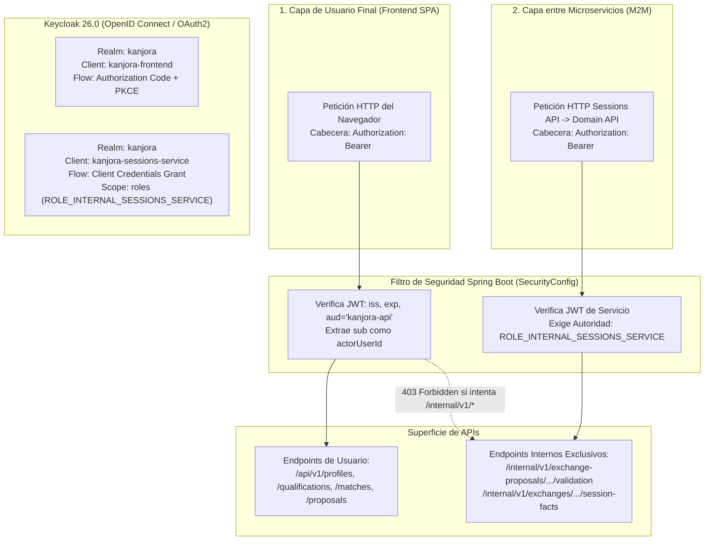

# Kanjora — Documento 05: Seguridad, Identidad y Gobernanza de APIs
**Modelo OIDC / OAuth2, Protección WebRTC e Integración Idempotente M2M**

---

## 1. Arquitectura de Seguridad de Doble Capa

Kanjora implementa un esquema de seguridad perimetral e interno riguroso, evitando la mezcla de privilegios de usuarios finales con llamadas de infraestructura:



---

## 2. Especificación de Tokens y Claims

### 2.1 Token de Usuario Final (OIDC Bearer JWT)
* **Algoritmo de Firma:** RSA256 con par de claves asimétricas provisto por el endpoint JWKS de Keycloak (`/protocol/openid-connect/certs`).
* **Claims Obligatorios:**
  * `iss` (Issuer): `http://localhost:8180/realms/kanjora` (configurable vía variable de entorno `OIDC_ISSUER_URI`).
  * `aud` (Audience): Debe contener explícitamente `kanjora-api`.
  * `exp` (Expiration Time): Duración máxima de 1 hora.
  * `sub` (Subject): Identificador UUID inmutable del usuario en Keycloak, utilizado como clave primaria (`user_id`) en `user_profiles`.

### 2.2 Token de Comunicación de Servicio (Machine-to-Machine)
* **Flujo OAuth2:** `Client Credentials Grant`.
* **Client ID:** `kanjora-sessions-service`.
* **Roles / Authorities:** Requiere la autoridad canónica `ROLE_INTERNAL_SESSIONS_SERVICE`.
* **Política de Rechazo:** Si un usuario final autenticado intenta consumir endpoints bajo la ruta `/internal/v1/**`, Spring Security detiene la petición de forma inmediata respondiendo `403 Forbidden` con código de error de dominio `FORBIDDEN`.

---

## 3. Seguridad en la Capa de Medios (LiveKit WebRTC)

Para garantizar la privacidad y prevenir intrusiones no autorizadas (*videobombing*) en las salas de clase:
1. **Cero Secretos en el Navegador:** Las credenciales maestras (`LIVEKIT_API_KEY` y `LIVEKIT_API_SECRET`) residen únicamente en Sessions API (Go).
2. **Tokens de Sala Efímeros (TTL 15 Minutos):**
   ```go
   // Ejemplo conceptual en Go (server-sdk-go)
   at := auth.NewAccessToken(apiKey, apiSecret)
   grant := &auth.VideoGrant{
       RoomJoin:     true,
       Room:         session.LiveKitRoomName,
       CanPublish:   true,
       CanSubscribe: true,
   }
   at.AddGrant(grant).
      SetIdentity(actorUserId).
      SetValidFor(15 * time.Minute)
   token, err := at.ToJWT()
   ```
3. **Validación Temporal Estricta:** El endpoint `POST /api/v1/sessions/{id}/room-token` rechaza la generación de tokens si la petición se realiza más de 15 minutos antes de la hora acordada (`scheduled_start_at`) o posterior a la hora de cierre (`scheduled_end_at`).

---

## 4. Gestión de Errores Normalizada (RFC 9457 Problem Details)

Tanto Java (Spring Boot) como Go (Sessions API) implementan el estándar de la IETF **RFC 9457 (Problem Details for HTTP APIs)** (`Content-Type: application/problem+json`):

```json
{
  "type": "https://api.kanjora.com/errors/NOT_ENOUGH_AVAILABLE_TIME",
  "title": "Tiempo común insuficiente",
  "status": 409,
  "detail": "La coincidencia recíproca con este candidato no alcanza el mínimo de 30 minutos semanales en común.",
  "instance": "/api/v1/matches",
  "code": "NOT_ENOUGH_AVAILABLE_TIME",
  "timestamp": "2026-11-18T07:15:00Z"
}
```

---

## 5. Idempotencia en Transacciones Distribuidas (RFC 7231)

### 5.1 Cabecera `Idempotency-Key`
Para proteger los endpoints de creación de recursos mutables contra reintentos por pérdidas de paquetes o caídas transitorias de conexión:
* El cliente debe generar un identificador único (UUIDv4) y enviarlo en la cabecera:
  `Idempotency-Key: 7b841a2e-4d82-4f3b-9e4a-9c7ef2b68310`.
* En Sessions API, la tabla `idempotency_keys` registra el hash SHA-256 del payload recibido, el código HTTP de respuesta y el body JSON devuelto.
* Ante peticiones repetidas con la misma clave dentro de una ventana de 24 horas, el motor intercepta la solicitud y devuelve de forma instantánea la respuesta cacheada sin re-ejecutar transacciones en base de datos.
