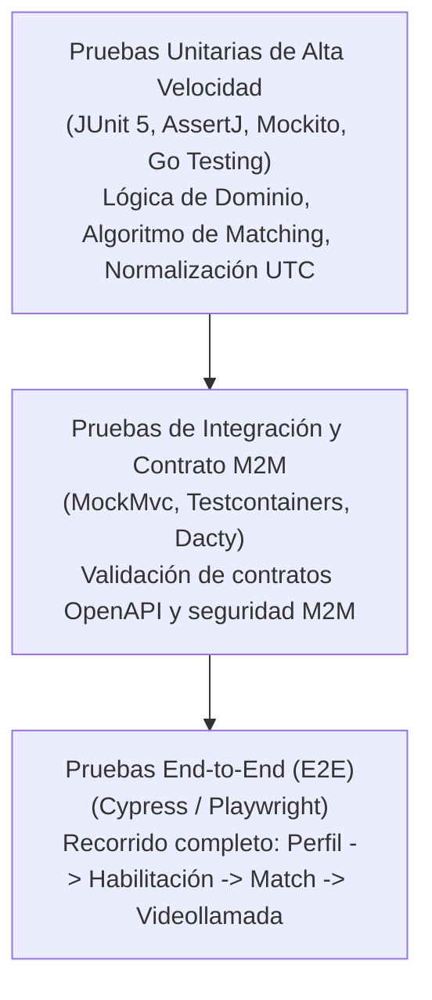
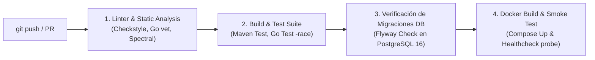

# Kanjora — Documento 06: Plan de Calidad, Testing, CI/CD y DevOps
**Estrategia Integral de Pruebas y Automatización de Despliegue Continuo**

---

## 1. Pirámide de Pruebas de Software

Kanjora adopta la pirámide de pruebas automatizadas para garantizar alta cobertura y detección temprana de defectos antes de llegar a producción:

### 1.1 Pruebas Unitarias (Domain API en Java y Sessions API en Go)
* **Objetivo:** Validar reglas de negocio puras sin latencia de red ni dependencias externas.
* **Componentes Críticos Evaluados:**
  * Algoritmo de normalización de zonas horarias en `MatchingServiceTest`: Casos de prueba con bordes semanales (ej. domingo 23:30 UTC a lunes 00:30 UTC en zona horaria de Tokio vs. Bogotá).
  * Validación de scores ponderados: $\text{Overlap} + (\text{Temas} \times 60.0)$.
  * Transición de estados de sesión y comprobación de bloque balanceado (10 a 90 min) en Go.

### 1.2 Pruebas de Integración y Seguridad (MockMvc & Spring Security)
* **Objetivo:** Comprobar que los filtros de autorización, la extracción de claims JWT y el manejo de excepciones de dominio respondan con los códigos de estado HTTP correctos.
* **Escenarios Clave Implementados (`SecurityAndProfileControllerTest.java`):**
  * Acceso anónimo a endpoints protegidos $\rightarrow$ `401 Unauthorized` con `ProblemDetail`.
  * Acceso de usuario convencional a `/internal/v1/*` $\rightarrow$ `403 Forbidden`.
  * Creación de perfil con franja horaria invertida (`end_time <= start_time`) $\rightarrow$ `422 Unprocessable Entity`.
  * Replay de peticiones con `Idempotency-Key` $\rightarrow$ `200 OK` idéntico sin duplicados.

---

## 2. Pipeline de CI/CD (GitHub Actions)

El flujo de integración continua está automatizado para ejecutarse en cada `push` y `pull_request` a la rama principal:

---

## 3. Guía de Operación y Despliegue a Producción

### 3.1 Transición del Entorno Local a Producción

| Componente | Entorno Local (Docker Compose) | Entorno Producción (Cloud Managed) |
| :--- | :--- | :--- |
| **Base de Datos** | Contenedor PostgreSQL 16 en puerto 5432 | Google Cloud SQL / AWS RDS PostgreSQL 16 Multi-AZ con backups continuos y encriptación KMS en reposo. |
| **Servidor WebRTC** | Contenedor `kanjora-livekit` en modo `--dev` | **LiveKit Cloud** (infraestructura global administrada con enrutamiento Anycast y edge SFU de baja latencia). |
| **Identidad / OIDC** | Keycloak 26 en contenedor en puerto 8180 | Keycloak en clúster de alta disponibilidad o Auth0 / Google Cloud Identity Platform. |
| **Microservicios** | Ejecución local mediante Maven y Go run | Contenedores orquestados en Google Cloud Run o AWS ECS Fargate con auto-escalado horizontal basado en CPU/Memoria. |
| **Gestión de Secretos**| Archivo `.env` / variables de entorno de compose | Google Secret Manager / AWS Secrets Manager con rotación de credenciales. |

### 3.2 Monitoreo y Observabilidad
* **Logs Estructurados:** Formato JSON con campos obligatorios: `timestamp`, `level`, `trace_id`, `span_id`, `service`, `message`.
* **Métricas Operativas:** Exposición de métricas en Prometheus (`/actuator/prometheus` en Spring Boot) para monitorizar:
  * Número de propuestas emitidas vs. aceptadas.
  * Tasa de emparejamientos exitosos sin coincidencia horaria ($0$ matches).
  * Latencia P95 de la API de matching.
  * Duración de videollamadas y tasa de desconexiones no planificadas.
