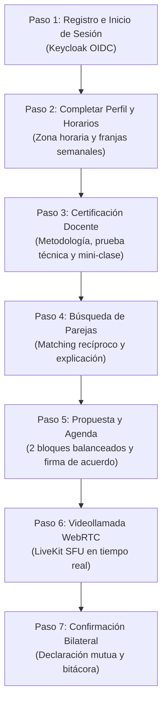
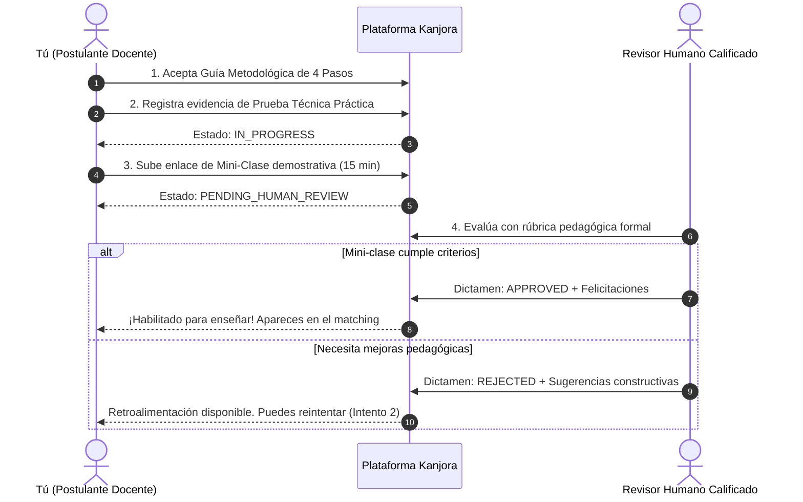

# Kanjora — Documento 07: Manual de Usuario y Guía Operativa
**Guía Integral Paso a Paso para Participantes y Revisores Docentes**

---

## 1. Introducción y Bienvenida a Kanjora

### 1.1 ¿Qué es Kanjora?
**Kanjora** es una plataforma colaborativa diseñada para el **trueque directo 1 a 1 de habilidades técnicas avanzadas**. En Kanjora no se compran clases con dinero ni con créditos comerciales; la regla de oro es la **reciprocidad pura**:
> *"Para aprender lo que necesitas, enseñas lo que dominas."*

El piloto actual está optimizado para el intercambio de alto impacto entre **Programación Backend** e **Inglés Técnico**:
* Si dominas desarrollo backend, enseñas arquitectura de APIs, bases de datos o testing a un colega.
* A cambio, tu pareja de intercambio (con fluidez en el idioma) te guía en sesiones prácticas de inglés conversacional enfocado en entrevistas técnicas, dailies ágiles o presentaciones de arquitectura.

---

### 1.2 Requisitos del Sistema y del Entorno

Antes de iniciar una sesión de intercambio, asegúrate de cumplir con los siguientes requisitos mínimos:

| Componente | Requisito Recomendado | Verificación Rápida |
| :--- | :--- | :--- |
| **Navegador Web** | Google Chrome 110+, Mozilla Firefox 115+, Microsoft Edge 110+ o Safari 16+. | Compatible con WebRTC nativo y WebSockets. |
| **Conexión a Internet** | Banda ancha cableada o Wi-Fi estable de mínimo **5 Mbps de subida y 10 Mbps de bajada**. | Ping < 100 ms hacia servidores locales. |
| **Hardware Multimedia** | Cámara web HD (720p o superior) y **auriculares con micrófono incorporado**. | Evitar altavoces abiertos para prevenir eco o acople de audio. |
| **Entorno Físico** | Espacio silencioso, bien iluminado y sin distracciones. | Privacidad para hablar con claridad. |

---

## 2. Flujo Integral del Participante: De Cero a la Videollamada



---

### Paso 1: Registro e Inicio de Sesión Seguro
1. Ingresa a la dirección web de Kanjora (`http://localhost:4200` o dominio en producción).
2. Haz clic en el botón **"Iniciar Sesión con Kanjora ID"**.
3. Serás redirigido a la pantalla centralizada de identidad (Keycloak OIDC):
   * Si es tu primera vez, pulsa **"Registrarse"** e introduce tu correo electrónico institucional o personal, nombre y contraseña segura.
   * Si ya tienes cuenta, ingresa tus credenciales y haz clic en **"Entrar"**.
4. Una vez autenticado, serás redirigido automáticamente a tu panel principal en Kanjora.

---

### Paso 2: Configuración de Perfil, Metas y Disponibilidad Semanal
Para que el motor de emparejamiento pueda encontrar a tu contraparte ideal, es indispensable completar tu ficha de usuario:

```
┌────────────────────────────────────────────────────────────────────────┐
│                        MI PERFIL EN KANJORA                            │
├────────────────────────────────────────────────────────────────────────┤
│ Nombre Visible:   [ David Desarrollador                              ] │
│ Biografía Corta:  [ Ing. de Software con 5 años en Java/PostgreSQL   ] │
│ Zona Horaria:     [ America/Bogota (UTC-5)                         ▼ ] │
├────────────────────────────────────────────────────────────────────────┤
│ ¿QUÉ DESEO APRENDER? (Metas de Aprendizaje)                           │
│ • Habilidad: Inglés Técnico  | Nivel: B2 - Intermedio Alto             │
│   Temas: [X] Entrevistas técnicas  [X] Presentaciones de arquitectura  │
├────────────────────────────────────────────────────────────────────────┤
│ ¿QUÉ OFREZCO ENSEÑAR? (Ofertas Docentes)                               │
│ • Habilidad: Programación Backend | Nivel: Intermedio                  │
│   Temas: [X] APIs REST con OpenAPI  [X] Modelado relacional SQL        │
├────────────────────────────────────────────────────────────────────────┤
│ MI DISPONIBILIDAD HORARIA SEMANAL                                      │
│ • Martes:   18:00 a 20:00 (Hora Local)                                 │
│ • Jueves:   18:00 a 20:00 (Hora Local)                                 │
│ • Sábados:  09:00 a 12:00 (Hora Local)                                 │
│                                           [ GUARDAR MI DISPONIBILIDAD ]│
└────────────────────────────────────────────────────────────────────────┘
```

> [!IMPORTANT]
> **El valor de la zona horaria:** Kanjora convierte internamente tus horarios a minutos universales UTC. Si tú estás en Bogotá (`UTC-5`) y tu contraparte en Madrid (`UTC+1`), la plataforma detectará automáticamente cuándo coinciden sin que tengas que hacer cálculos manuales.

---

### Paso 3: Habilitación Docente en 3 Etapas (Quality Gate)
Para proteger la calidad de los intercambios, nadie puede ofrecer enseñanza sin haber superado el proceso de habilitación docente:



#### Los 4 Pasos Metodológicos Obligatorios de Kanjora:
1. **Objetivo Claro (2 min):** Explicar con precisión qué habilidad práctica dominará el estudiante al finalizar el bloque.
2. **Explicación Concreta (8 min):** Concepto esencial con un ejemplo real de código o comunicación técnica.
3. **Práctica Guiada (15 min):** El aprendiz escribe el código o practica el diálogo mientras tú brindas retroalimentación inmediata.
4. **Comprobación (5 min):** Ejercicio breve de cierre para verificar que el conocimiento quedó afianzado.

---

### Paso 4: Búsqueda y Emparejamiento Recíproco Explicable
1. En el menú superior, pulsa **"Buscar Parejas"**.
2. El sistema analiza la base de datos en milisegundos buscando a alguien que cumpla dos condiciones al mismo tiempo:
   * **Enseña lo que tú buscas aprender** y **desea aprender lo que tú estás habilitado para enseñar**.
   * **Comparte al menos 30 minutos semanales** de coincidencia horaria contigo.
3. Verás una tarjeta de candidato transparente:

```
┌────────────────────────────────────────────────────────────────────────┐
│  👤 Carlos Mendoza                     ⭐⭐⭐⭐⭐ Match Score: 180 pts  │
├────────────────────────────────────────────────────────────────────────┤
│  Te enseña:  Inglés Técnico (Nivel B2)                                 │
│  Aprende:    Programación Backend (Nivel Intermedio)                   │
├────────────────────────────────────────────────────────────────────────┤
│  💡 ¿POR QUÉ ENCAJAN? (Explicación Transparente)                        │
│  • Coinciden 120 minutos semanales en común:                           │
│    - Martes 23:00-01:00 UTC (18:00-20:00 tu hora local).               │
│  • Comparten 1 tema afín: "Diseño y presentación de APIs REST".        │
│  • Sin publicidad ni ventajas de pago: ordenado por pura compatibilidad│
├────────────────────────────────────────────────────────────────────────┤
│  [ VER RUTA SUGERIDA ]                     [ ENVIAR PROPUESTA TRUEQUE ]│
└────────────────────────────────────────────────────────────────────────┘
```

---

### Paso 5: Negociación, Agenda y Firma del Acuerdo Bilateral
1. Al pulsar **"Enviar Propuesta"**, se abre el asistente de agendamiento.
2. Selecciona una fecha y hora dentro de las franjas comunes detectadas.
3. **Estructura los dos bloques pedagógicos (Total estándar: 60 minutos):**
   * **Bloque 1 (30 min):** David enseña Programación Backend (Diseño de APIs con OpenAPI).
   * **Bloque 2 (30 min):** Carlos enseña Inglés Técnico (Simulación de entrevista técnica en inglés).
4. **Firma del Acuerdo de Convivencia:**
   Antes de confirmar, ambas partes deben leer y marcar la casilla de aceptación del compromiso:
   * *Puntualidad rigurosa.*
   * *Respeto mutuo y ambiente constructivo de aprendizaje.*
   * *Compromiso de ejecutar ambos bloques sin abandonar a la mitad.*
5. Cuando tu compañero acepta la propuesta y firma el acuerdo, la sesión pasa al estado **"SCHEDULED" (Programada)**.

---

### Paso 6: La Videollamada en Vivo (WebRTC con LiveKit)

```
┌────────────────────────────────────────────────────────────────────────┐
│ KANJORA LIVE ROOM: backend-eng-exchange-uuid4            ⏱️ 00:28:45   │
├───────────────────────────────────┬────────────────────────────────────┤
│                                   │                                    │
│       [ VIDEO TU COMPAÑERO ]      │           [ TU CÁMARA ]            │
│       Carlos Mendoza (Inglés)     │           David (Backend)          │
│                                   │                                    │
├───────────────────────────────────┴────────────────────────────────────┤
│ GUÍA DE SESIÓN ACTIVA: Bloque 1 (David enseña Backend)                 │
│ [X] 1. Objetivo (2m)  [X] 2. Concepto (8m)  [ ] 3. Práctica (15m) ...  │
├────────────────────────────────────────────────────────────────────────┤
│ 🎤 [Silenciar]  📹 [Apagar Cámara]  🖥️ [Compartir Pantalla]  🔴 [Cerrar] │
└────────────────────────────────────────────────────────────────────────┘
```

1. **Ingreso a la Sala:** El botón **"Entrar a la Videollamada"** se activará **15 minutos antes** de la hora acordada.
2. **Permisos del Navegador:** Al pulsar el botón, el navegador solicitará acceso a tu micrófono y cámara. Haz clic en **"Permitir"**.
3. **Panel de Guía Pedagógica:** Durante la llamada, verás un panel lateral con los 4 pasos metodológicos para que no pierdan el rumbo y aprovechen al máximo el tiempo.
4. **Cambio de Turno:** Al cumplirse el minuto 30, la interfaz notificará el cambio de bloque: quien estaba aprendiendo pasa a enseñar, invirtiendo los roles de forma natural.

---

### Paso 7: Cierre y Confirmación Bilateral de Cumplimiento
Al finalizar la videollamada, la plataforma te dirigirá a la pantalla de confirmación:
1. **¿Se ejecutaron ambos bloques de enseñanza?** Marca **Sí** o **No**.
2. **Resultado de la sesión:**
   * `Completada con éxito`: Ambos aprendieron y enseñaron según lo planeado.
   * `Problema técnico imprevisto`: Falla de luz o caída de conexión.
   * `Ausencia de la pareja (No-show)`: El compañero no asistió a la llamada.
   * `Abandono prematuro`: El compañero se desconectó intencionalmente.
3. **Notas de progreso:** Escribe un breve resumen de lo aprendido para tu bitácora personal.
4. **¿Repetirías intercambio con este colega?** Valoración de afinidad.

> [!NOTE]
> **Resolución ética:** Si ambos confirman que la sesión fue exitosa, el intercambio pasa a **CONFIRMADO**. Si hay alguna discrepancia (por ejemplo, una caída de internet), el sistema **no impone sanciones automáticas**, sino que deriva el caso a revisión humana justa.

---

## 3. Guía Operativa para Revisores Docentes (Administradores)

Los revisores docentes son los guardianes de la calidad pedagógica de Kanjora. Su rol es asegurar que todo aquel que enseñe aplique la estructura didáctica correcta.

### 3.1 Acceso al Panel de Evaluación
1. Inicia sesión con una cuenta autorizada que cuente con el rol `ROLE_REVIEWER` o `ROLE_ADMIN`.
2. En el menú de navegación, ingresa a **"Panel de Evaluación Docente"** (`/admin/mini-class-submissions`).
3. Visualizarás la cola de solicitudes pendientes ordenadas por fecha de envío.

---

### 3.2 Rúbrica de Evaluación de Mini-Clases (15 Minutos)

Para aprobar una entrega, el revisor debe verificar el cumplimiento de los siguientes 4 criterios:

| Criterio Evaluado | Ponderación | ¿Qué debe buscar el revisor? | Criterio de Rechazo Inmediato |
| :--- | :---: | :--- | :--- |
| **1. Claridad del Objetivo** | 20% | El docente define en los primeros 2 minutos qué ejercicio práctico resolverá el aprendiz. | Iniciar a hablar de teoría genérica sin definir qué se va a construir o resolver. |
| **2. Concisión Conceptual** | 30% | La teoría no supera los 8 minutos y usa un ejemplo real (código concreto o vocabulario en contexto). | Monólogo teórico denso de diapositivas que consuma más del 60% del tiempo. |
| **3. Dinámica Práctica** | 35% | Se cede el control al estudiante: el docente formula preguntas o guía la escritura de código. | Docente que hace todo el ejercicio en silencio sin involucrar al compañero. |
| **4. Comprobación y Cierre** | 15% | Se valida el aprendizaje con una pregunta reflexiva o comprobación final. | Terminar abruptamente sin verificar si el aprendiz comprendió el concepto. |

---

### 3.3 Emisión del Dictamen
* **Si la mini-clase es Aprobada (`APPROVED`):**
  Redacta comentarios destacando las fortalezas pedagógicas del aspirante y pulsa **"Aprobar Habilitación"**. El candidato quedará inmediatamente visible en el motor de emparejamiento.
* **Si la mini-clase es Desaprobada (`REJECTED`):**
  Redacta un feedback detallado, respetuoso y constructivo explicando exactamente qué punto de la rúbrica debe corregir (ej. *"Tu explicación técnica fue muy buena, pero consumió 13 minutos y no dejaste espacio para la práctica guiada. Te recomendamos acortar la teoría a 7 minutos e incorporar un ejercicio interactivo"*). Pulsa **"Solicitar Nuevo Intento"**.

---

## 4. Preguntas Frecuentes y Resolución de Problemas (Troubleshooting)

### ❓ No encuentro parejas compatibles, ¿qué puedo hacer?
1. **Revisa tu disponibilidad semanal:** Cuantas más franjas horarias registres en `Mi Perfil`, mayor será la probabilidad matemática de encontrar coincidencias.
2. **Agrega más temas de interés:** Selecciona temas adicionales dentro de tu habilidad objetivo.
3. **Recuerda que la búsqueda sigue activa:** Kanjora no fuerza coincidencias incompatibles. En cuanto otro usuario con tus intereses y horarios se registre o habilite, aparecerá en tu listado.

---

### ❓ Mi cámara o micrófono no funcionan dentro de la sala
1. Comprueba que el navegador tenga permisos concedidos para `localhost` o el dominio de Kanjora (icono del candado junto a la URL en la barra de direcciones).
2. Asegúrate de no tener otra aplicación abierta que esté usando la cámara (como Zoom, Teams, Google Meet o Discord).
3. Si el problema persiste, abre la sala en una pestaña de incógnito sin extensiones que puedan bloquear WebSockets o WebRTC.

---

### ❓ Mi compañero no se presentó a la sesión (No-Show)
* Espera un margen de cortesía de **10 minutos** dentro de la sala.
* Si no ingresa, abandona la llamada y en la pantalla de confirmación selecciona: **"Ausencia de la pareja (No-show)"**.
* El sistema registrará el hecho para análisis administrativo. Las ausencias aisladas por emergencias no conllevan sanciones, pero los incumplimientos reiterados sin aviso limitan temporalmente la posibilidad de agendar nuevas sesiones.

---

### ❓ Tuve un fallo eléctrico o se cayó mi conexión a internet
* No te preocupes: Kanjora comprende que las fallas técnicas ocurren.
* En cuanto recuperes conexión, ingresa a la sesión y declara **"Problema técnico imprevisto"**.
* El intercambio se clasificará como pendiente de revisión (`PENDING_REVIEW`) sin afectar negativamente tu reputación ni penalizar a ninguna de las partes. Podrán volver a proponer un nuevo horario de común acuerdo.

---

### ❓ Mi mini-clase fue rechazada, ¿puedo volver a intentar?
* **¡Sí, totalmente!** Kanjora es un espacio de aprendizaje continuo.
* Lee con atención los comentarios dejados por el revisor en la pestaña **"Mi Habilitación"**.
* Graba un nuevo video aplicando las sugerencias pedagógicas y súbelo como **Intento 2**. Tu nueva entrega volverá a la cola de revisión sin costo alguno.

---

## 5. Glosario de Términos para el Usuario

* **Trueque Recíproco 1:1:** Modelo de intercambio directo de conocimientos donde dos personas se turnan para ser docente y estudiante en una misma sesión.
* **Habilitación Docente:** Certificado interno emitido por revisores humanos que acredita que un participante está capacitado para enseñar una materia bajo la metodología Kanjora.
* **Match Score:** Puntuación matemática que mide la compatibilidad de horarios y afinidad temática entre dos usuarios, sin sesgos publicitarios ni compras de visibilidad.
* **Bloque Pedagógico:** Periodo estructurado de 30 minutos dedicado exclusivamente a una de las dos materias acordadas.
* **LiveKit SFU:** Tecnología de transmisión de audio y video en tiempo real de baja latencia utilizada por Kanjora para las videollamadas privadas.
