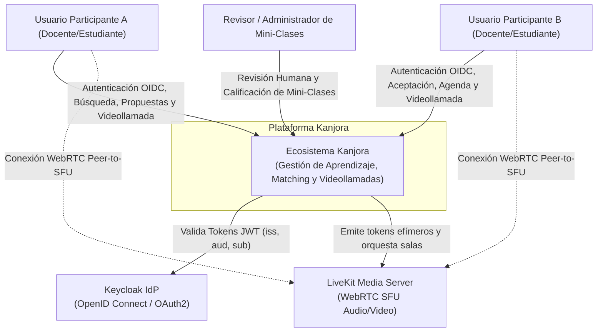
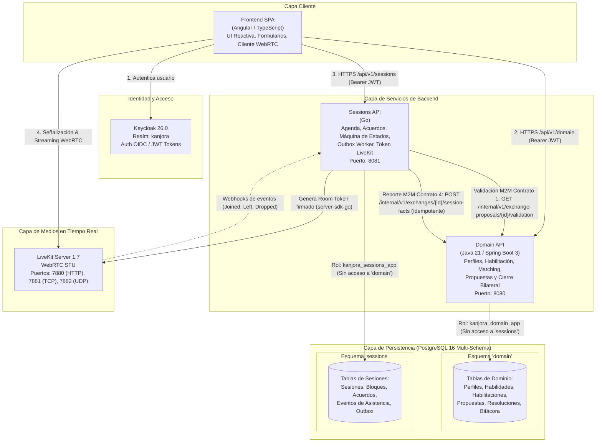
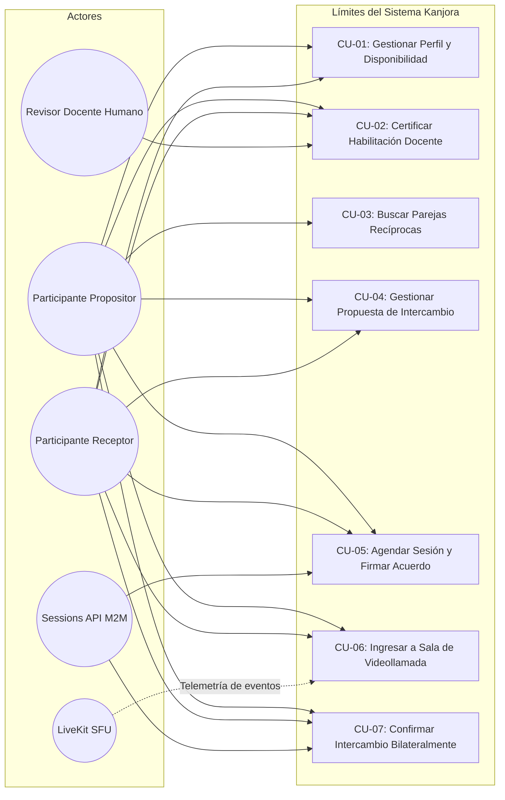
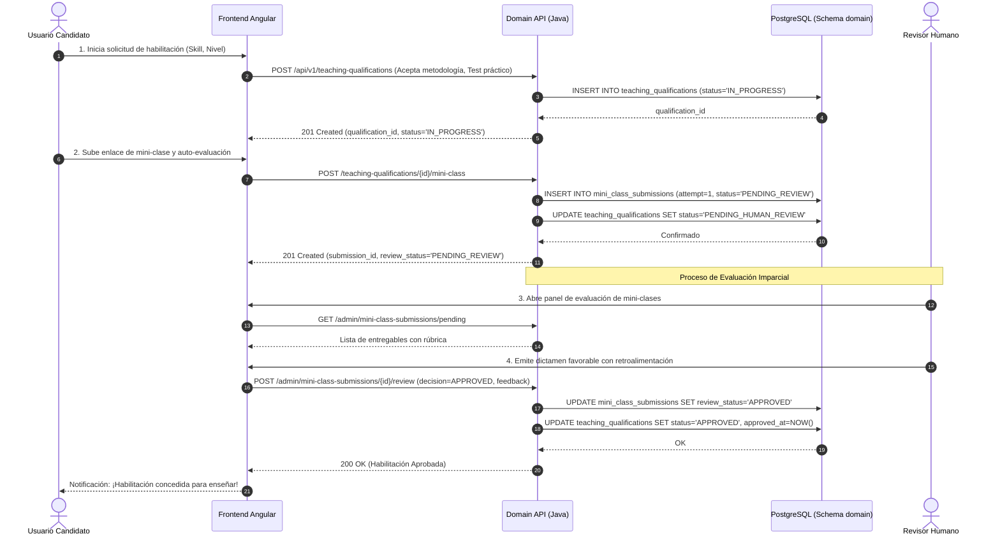
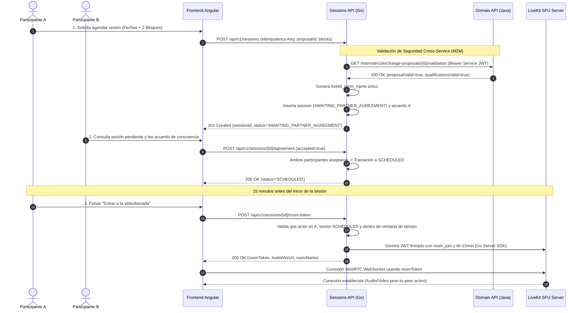
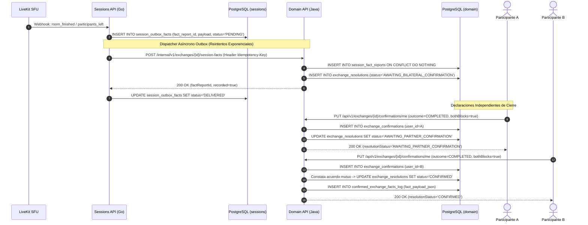
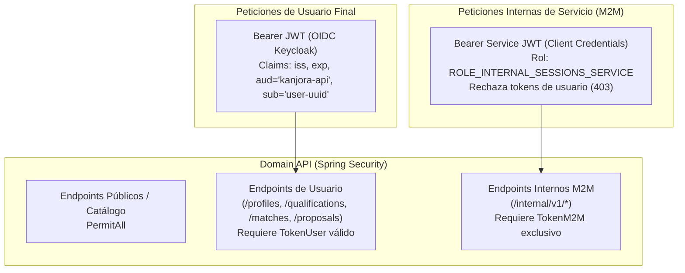

# Kanjora — Documentación Técnica y Especificación de Ingeniería de Software
**Plataforma Distribuida de Aprendizaje e Intercambio Técnico Recíproco 1:1**

---

## 1. Ficha Ejecutiva y Visión del Producto

### 1.1 Resumen Ejecutivo
**Kanjora** es una plataforma de software distribuida diseñada para facilitar el **trueque y aprendizaje colaborativo 1 a 1 de habilidades técnicas de alta demanda**. El piloto de lanzamiento inicial (MVP) aborda el intercambio recíproco entre **Programación Backend** e **Inglés Técnico**: dos profesionales habilitados para enseñar se encuentran mediante un algoritmo de emparejamiento explicable, pactan una agenda, aceptan un acuerdo mutuo, ejecutan una videollamada interactiva dividida en dos bloques de enseñanza y confirman bilateralmente el resultado del intercambio.

### 1.2 Principios Rectores y Filosofía de Diseño
A diferencia de las plataformas tradicionales de cursos grabados o marketplaces de tutorías pagadas, Kanjora se fundamenta en cinco pilares innegociables:
1. **Trueque Directo y Recíproco Puro:** Cada integrante debe enseñar algo que la otra persona desea aprender. Los créditos no compran clases; el acceso es igualitario y basado en la reciprocidad de conocimiento.
2. **Habilitación Docente Auditada (Quality Gate):** Para ofrecer enseñanza en una habilidad y nivel, no basta con autodeclararse competente. Se requiere superar una prueba práctica y una mini-clase evaluada por revisores humanos bajo una metodología estructurada (*Objetivo, Explicación, Práctica guiada y Comprobación*).
3. **Emparejamiento Explicable (Sin Pay-to-Win):** El sistema propone parejas únicamente cuando existe reciprocidad estricta de metas y disponibilidad horaria común. El ordenamiento es transparente y auditable; las cuentas VIP o créditos no alteran la posición de búsqueda.
4. **Arquitectura Desacoplada y Soberanía de Datos:** Separación estricta entre el dominio de negocio (gestión de perfiles, catálogo, habilitaciones y matching en Java/Spring Boot) y la orquestación en tiempo real (gestión de agendas, state machine de sesión y tokens de sala en Go). El aislamiento se traslada hasta el motor de base de datos relacional mediante esquemas lógicos y credenciales independientes.
5. **Resiliencia e Idempotencia Operacional:** Todas las transacciones cross-service y reportes de telemetría de videollamada implementan el patrón Transaccional Outbox y cabeceras `Idempotency-Key` (RFC 9457 / RFC 7231), garantizando que las fallas de red no generen estados inconsistentes ni duplicación de efectos.

---

## 2. Arquitectura de Software y Modelos C4

### 2.1 Vista de Contexto del Sistema (C4 - Nivel 1)



### 2.2 Vista de Contenedores y Microservicios (C4 - Nivel 2)



### 2.3 Patrón de Aislamiento Lógico de Datos (Database-per-Service)
A fin de evitar acoplamientos espurios y dependencias directas de base de datos, Kanjora aplica aislamiento a nivel de motor PostgreSQL:
- **Usuario `kanjora_domain_app`**: Posee el esquema `domain`. Se le revoca acceso explícito a `public` y a `sessions`.
- **Usuario `kanjora_sessions_app`**: Posee el esquema `sessions`. Se le revoca acceso explícito a `public` y a `domain`.
- **Cero Cross-Schema Queries:** Ni joins ni subconsultas cruzadas entre esquemas. Toda integración entre `domain` y `sessions` se realiza mediante contratos HTTP REST OpenAPI 3.1 fuertemente tipados.

---

## 3. Especificación de Requisitos del Sistema (SRS)

### 3.1 Requisitos Funcionales (RF)

| ID | Nombre del Requisito | Módulo | Descripción Funcional | Prioridad (MoSCoW) | Criterio de Aceptación |
| :--- | :--- | :--- | :--- | :--- | :--- |
| **RF-01** | Catálogo Configurable | Catálogo | El sistema debe exponer el catálogo de categorías, habilidades, niveles y temas como entidades dinámicas en base de datos, sin acoplamiento a valores fijos en código. | Must have | `GET /api/v1/catalog/skills` retorna categorías, niveles ordenados por `rank_order` y temas activos. |
| **RF-02** | Rutas y Guías Gratuitas | Catálogo | El sistema debe proveer guías de estudio básicas y metodología pedagógica en formato Markdown accesibles libremente para cualquier usuario autenticado. | Must have | Registros en `study_guides` con `is_free=true` consultables sin créditos ni restricciones. |
| **RF-03** | Gestión de Perfil y Zona Horaria | Perfiles | El usuario debe poder configurar su nombre para mostrar, biografía corta, zona horaria canónica IANA y franjas de disponibilidad semanal. | Must have | `PUT /api/v1/profiles/me` persiste slots con validación `end_time_local > start_time_local` y día entre 1 y 7. |
| **RF-04** | Definición de Ofertas y Metas | Perfiles | El usuario puede registrar qué desea aprender (`user_learning_goals`) y qué habilidades ofrece enseñar (`user_teaching_offers`), asociadas a niveles y temas específicos. | Must have | Validación de unicidad `(user_id, skill_id)` y coherencia referencial de clave foránea compuesta `(level_id, skill_id)`. |
| **RF-05** | Solicitud de Habilitación Docente | Habilitaciones | Para ofrecer enseñanza, el usuario debe solicitar una habilitación para la tupla `(skill_id, level_id)`, reconociendo la metodología de 4 pasos de Kanjora. | Must have | Estado inicial `IN_PROGRESS`; requiere `methodology_acknowledged = true`. |
| **RF-06** | Prueba Práctica de Habilitación | Habilitaciones | El candidato debe registrar la resolución de una prueba práctica técnica vinculada al nivel solicitado. | Must have | `practical_test_passed = true` y referencia técnica persistida. No se puede aprobar sin este indicador. |
| **RF-07** | Envío de Mini-Clase | Habilitaciones | El candidato debe enviar una grabación o artefacto de mini-clase explicando el objetivo, auto-evaluación y enlace público del entregable. | Must have | `POST /teaching-qualifications/{id}/mini-class` crea intento incremental (`attempt_number >= 1`) en `PENDING_REVIEW`. |
| **RF-08** | Revisión Humana de Mini-Clase | Habilitaciones | Un revisor calificado debe evaluar la mini-clase, emitiendo una decisión formal (`APPROVED` o `REJECTED`) acompañada de feedback constructivo obligatorio. | Must have | `POST /admin/mini-class-submissions/{id}/review` solo ejecutable por revisores autorizados. Si aprueba, cambia estado a `APPROVED`. |
| **RF-09** | Emparejamiento Recíproco Explicable | Matching | El motor de emparejamiento debe buscar usuarios donde A enseñe lo que B busca y B enseñe lo que A busca, con habilitaciones aprobadas vigentes y al menos 30 min semanales coincidentes. | Must have | `GET /api/v1/matches` computa intervalos normalizados UTC e incluye desglose explicativo del score sin sesgo publicitario. |
| **RF-10** | Creación de Propuesta de Intercambio | Propuestas | Un usuario puede enviar una propuesta formal de intercambio a un candidato compatible, fijando las habilidades y niveles que cada uno enseñará. | Must have | `POST /api/v1/exchange-proposals` valida en BD que ambas partes cuenten con habilitación aprobada (`APPROVED`). |
| **RF-11** | Negociación de Propuesta | Propuestas | El destinatario puede aceptar (`ACCEPTED`) o rechazar (`REJECTED` con motivo) la propuesta de intercambio. | Must have | Solo el usuario destinatario puede responder; la aceptación habilita la creación de la sesión en el servicio de sesiones. |
| **RF-12** | Validación M2M de Propuesta | Integración | La API de Sesiones (Go) debe consultar a la API de Dominio (Java) la validez formal de la propuesta antes de permitir el agendamiento. | Must have | `GET /internal/v1/exchange-proposals/{id}/validation` valida autenticación M2M de servicio y devuelve estado y habilitaciones. |
| **RF-13** | Agendamiento y Creación de Sesión | Sesiones | Creación de la sesión con fecha y hora acordada, configurando exactamente dos bloques de enseñanza balanceados (10 a 90 min c/u). | Must have | `POST /api/v1/sessions` exige `Idempotency-Key`, valida fecha futura y crea la sala única para LiveKit. |
| **RF-14** | Aceptación Bilateral del Acuerdo | Sesiones | Ambos participantes deben aceptar explícitamente las reglas de convivencia y compromiso antes de habilitar el ingreso a la sala. | Must have | Cada participante firma `session_agreements`. La sesión transiciona a `SCHEDULED` cuando ambos han aceptado. |
| **RF-15** | Emisión de Token de Sala Seguro | Sesiones | Generación de tokens JWT de LiveKit de corta duración (máximo 15 minutos) exclusivamente para los dos participantes asignados. | Must have | `POST /sessions/{id}/room-token` rechaza a terceros y valida ventana de tiempo permitida (desde 15 min antes del inicio). |
| **RF-16** | Cancelación y Reprogramación | Sesiones | Los participantes pueden cancelar o proponer una nueva fecha antes de la sesión sin penalizaciones injustas. | Should have | `POST /sessions/{id}/cancel` y `PATCH /sessions/{id}/reschedule` actualizan el estado visible en tiempo real. |
| **RF-17** | Ingestión Idempotente de Hechos | Integración | La API de Sesiones reporta a la API de Dominio el hecho de terminación de la llamada mediante el patrón Outbox. | Must have | `POST /internal/v1/exchanges/{id}/session-facts` recibe cabecera `Idempotency-Key` y previene duplicación ante reintentos. |
| **RF-18** | Confirmación Bilateral de Cierre | Confirmaciones | Ambos usuarios declaran de forma independiente el resultado del intercambio (`COMPLETED`, `PARTNER_NO_SHOW`, `TECHNICAL_ISSUE`, etc.). | Must have | Si ambos confirman `COMPLETED`, el intercambio pasa a `CONFIRMED`. Si hay discrepancias o incidentes, pasa a `PENDING_REVIEW`. |

---

### 3.2 Requisitos No Funcionales (RNF) — ISO/IEC 25010

| ID | Atributo de Calidad | Métrica / Restricción Técnica | Estrategia de Implementación en Kanjora |
| :--- | :--- | :--- | :--- |
| **RNF-01** | **Seguridad: Autenticación** | OpenID Connect estándar vía tokens JWT RSA256. | Integración con Keycloak 26.0. Ambas APIs validan firma de claves públicas JWKS, vigencia (`exp`), emisor (`iss`) y audiencia (`aud`). |
| **RNF-02** | **Seguridad: Autorización M2M** | Acceso a endpoints internos restringido a identidades de servicio. | Client Credentials Grant con rol `ROLE_INTERNAL_SESSIONS_SERVICE`. Los tokens de usuario final reciben rechazo inmediato con `403 Forbidden`. |
| **RNF-03** | **Seguridad: Aislamiento DB** | Principio de mínimo privilegio en base de datos. | Esquemas lógicos independientes `domain` y `sessions`. `REVOKE ALL` entre roles de aplicación para prevenir fugas transversales de datos. |
| **RNF-04** | **Seguridad: Videollamada** | Cero tokens estáticos o de larga vida en cliente. | Tokens de LiveKit firmados por el servidor Go con TTL de 15 minutos; permisos de suscripción y publicación limitados a la sala asignada. |
| **RNF-05** | **Rendimiento: Latencia de API** | Tiempo de respuesta P95 < 150 ms para consultas operacionales. | Índices compuestos en PostgreSQL (`idx_qualifications_approved_lookup`, `idx_availability_user_day`) y algoritmos en memoria con normalización semanal de minutos. |
| **RNF-06** | **Rendimiento: Media WebRTC** | Latencia de audio/video extremo a extremo < 200 ms. | LiveKit SFU (Selective Forwarding Unit) con transporte UDP optimizado en puerto 7882. |
| **RNF-07** | **Fiabilidad: Idempotencia** | 100% de tolerancia ante fallos de red y reintentos automáticos. | Soporte estricto de cabecera `Idempotency-Key` en operaciones de creación de sesión y en el endpoint de reporte de hechos `/internal/v1/exchanges/{id}/session-facts`. |
| **RNF-08** | **Fiabilidad: Entrega Garantizada** | Patrón Transaccional Outbox en Sessions API. | Los hechos de llamada se persisten en `session_outbox_facts` dentro de la transacción local de Go y un worker los despacha a Java con reintentos exponenciales. |
| **RNF-09** | **Mantenibilidad: Contratos** | Contratos de API versionados desacoplados de la implementación. | Especificaciones OpenAPI 3.1 (`domain-api-v1.yaml`, `sessions-api-v1.yaml`) como fuente única de verdad para backend y frontend. |
| **RNF-10** | **Mantenibilidad: Calidad de Código** | Clean Architecture / DDD (Domain-Driven Design). | Separación en capas: Controllers REST, DTOs inmutables (Java Records / Go Structs), Servicios de Dominio transaccionales y Repositorios. |
| **RNF-11** | **Disponibilidad y Salud** | Monitorización de salud de servicios en tiempo de ejecución. | Endpoints de Healthcheck en contenedores (`pg_isready` en PostgreSQL, TCP probe en Keycloak, HTTP health en APIs). |
| **RNF-12** | **Trazabilidad y Auditoría** | Registro estructurado de eventos de cierre sin sesgos automáticos. | Tabla `confirmed_exchange_facts_log` inmutable (append-only) con payload JSON detallado para análisis posterior sin aplicar sanciones punitivas arbitrarias. |

---

## 4. Matriz de Trazabilidad de Requisitos (RTM)

La siguiente matriz conecta los requisitos funcionales con los casos de uso, los componentes de software, los contratos de interfaz, las tablas de persistencia y el criterio de verificación en Scrum:

| ID Req | Caso de Uso | Componente / Servicio | Contrato OpenAPI / Endpoint | Tabla(s) Involucrada(s) | Sprint / Verificación |
| :--- | :--- | :--- | :--- | :--- | :--- |
| **RF-01** | CU-01 | Domain API (Java) | `GET /api/v1/catalog/skills` | `skill_categories`, `skills`, `skill_levels`, `skill_topics` | Sprint 1 / Test Integración Catálogo |
| **RF-02** | CU-01 | Domain API (Java) | `GET /api/v1/catalog/skills` | `study_guides` | Sprint 1 / Verificación `is_free=true` |
| **RF-03** | CU-01 | Domain API (Java) | `GET/PUT /api/v1/profiles/me` | `user_profiles`, `user_availability_slots` | Sprint 1 / Demo Persistencia de Perfil |
| **RF-04** | CU-01 | Domain API (Java) | `PUT /api/v1/profiles/me` | `user_learning_goals`, `user_teaching_offers` | Sprint 1 / Verificación constraints de FK |
| **RF-05** | CU-02 | Domain API (Java) | `POST /api/v1/teaching-qualifications` | `teaching_qualifications` | Sprint 2 / Creación de trámite docente |
| **RF-06** | CU-02 | Domain API (Java) | `POST /api/v1/teaching-qualifications` | `teaching_qualifications` | Sprint 2 / Test validación prueba práctica |
| **RF-07** | CU-02 | Domain API (Java) | `POST /teaching-qualifications/{id}/mini-class` | `mini_class_submissions` | Sprint 2 / Envío de entregable multimedia |
| **RF-08** | CU-02 | Domain API (Java) | `POST /admin/mini-class-submissions/{id}/review` | `mini_class_submissions`, `teaching_qualifications` | Sprint 2 / Aprobación con feedback de revisor |
| **RF-09** | CU-03 | Domain API (Java) | `GET /api/v1/matches` | `teaching_qualifications`, `user_availability_slots` | Sprint 3 / Algoritmo Matching Recíproco |
| **RF-10** | CU-04 | Domain API (Java) | `POST /api/v1/exchange-proposals` | `exchange_proposals`, `teaching_qualifications` | Sprint 3 / Creación propuesta con validación doble |
| **RF-11** | CU-04 | Domain API (Java) | `POST /exchange-proposals/{id}/respond` | `exchange_proposals` | Sprint 3 / Transición a `ACCEPTED` o `REJECTED` |
| **RF-12** | CU-05 | Sessions API (Go) | `GET /internal/v1/exchange-proposals/{id}/validation` | `exchange_proposals` (vía Domain API) | Sprint 4 / Test de contrato M2M entre servicios |
| **RF-13** | CU-05 | Sessions API (Go) | `POST /api/v1/sessions` | `sessions`, `session_blocks`, `idempotency_keys` | Sprint 4 / Agendamiento y dos bloques |
| **RF-14** | CU-05 | Sessions API (Go) | `POST /api/v1/sessions/{id}/agreement` | `session_agreements`, `sessions` | Sprint 4 / Transición a `SCHEDULED` |
| **RF-15** | CU-06 | Sessions API (Go) | `POST /api/v1/sessions/{id}/room-token` | `session_attendance_events` (LiveKit SDK) | Sprint 4 / Emisión token WebRTC de 15 min |
| **RF-16** | CU-05 | Sessions API (Go) | `POST /cancel`, `PATCH /reschedule` | `sessions`, `session_agreements` | Sprint 4 / Reprogramación sin sanción |
| **RF-17** | CU-07 | Sessions API -> Domain | `POST /internal/v1/exchanges/{id}/session-facts` | `session_outbox_facts` -> `session_fact_reports` | Sprint 5 / Ingestión Outbox Idempotente |
| **RF-18** | CU-07 | Domain API (Java) | `PUT /exchanges/{id}/confirmations/me` | `exchange_confirmations`, `exchange_resolutions`, `confirmed_exchange_facts_log` | Sprint 5 / Cierre bilateral y auditoría |
| **RF-19** | CU-07 | Domain API (Java) | `GET /api/v1/exchanges/history/me` | `exchange_proposals`, `exchange_resolutions`, `exchange_confirmations` | Sprint 5 / Historial del participante |
| **RF-20** | CU-02/07 | Domain API (Java) | `GET /api/v1/admin/metrics/pilot` | `user_profiles`, `teaching_qualifications`, `exchange_proposals`, `confirmed_exchange_facts_log` | Sprint 6 / Métricas del piloto |

---

## 5. Casos de Uso Detallados (Use Cases)

### 5.1 Diagrama General de Casos de Uso (UML)



---

### 5.2 Fichas Técnicas de Casos de Uso de Alto Impacto

#### CU-02: Certificación y Habilitación Docente con Revisión Humana
* **Actor Principal:** Usuario Candidato a Enseñante.
* **Actor Secundario:** Revisor Humano Calificado.
* **Precondición:** El usuario ha autenticado su sesión y posee un perfil registrado.
* **Disparador:** El usuario pulsa "Habilitarme para Enseñar" en una habilidad y nivel seleccionados.
* **Flujo Principal (Paso a Paso):**
  1. El usuario visualiza la guía pedagógica de 4 pasos de Kanjora (*Objetivo, Explicación, Práctica, Comprobación*) y marca la aceptación expresa de la metodología.
  2. El usuario introduce la evidencia y aprobación de la prueba práctica breve.
  3. El sistema crea el registro en `teaching_qualifications` en estado `IN_PROGRESS`.
  4. El usuario completa el formulario de mini-clase aportando el objetivo pedagógico de la sesión, auto-evaluación y enlace público al artefacto/video demostrativo.
  5. El sistema incrementa el número de intento (`attempt_number`), crea el registro en `mini_class_submissions` y actualiza la habilitación a `PENDING_HUMAN_REVIEW`.
  6. El Revisor accede a la cola de revisiones administrativas (`/admin/mini-class-submissions/{id}/review`).
  7. El Revisor evalúa la estructura pedagógica y emite su veredicto (`APPROVED`) junto con observaciones detalladas.
  8. El sistema actualiza el estado de la habilitación a `APPROVED`, activa el timestamp `approved_at` e indexa al usuario como candidato apto para emparejamientos.
* **Flujos Alternativos:**
  * **7a. Mini-clase rechazada (`REJECTED`):** El Revisor consigna los aspectos a mejorar. La habilitación pasa a `REJECTED`. El usuario recibe el feedback en su interfaz y queda facultado para registrar un nuevo intento (`attempt_number + 1`) sin penalizaciones.
* **Postcondición:** El usuario queda oficialmente habilitado para ofrecer dicha habilidad y nivel en las búsquedas recíprocas.

---

#### CU-03: Búsqueda y Emparejamiento Recíproco Explicable
* **Actor Principal:** Usuario Interesado en Realizar un Intercambio.
* **Precondiciones:**
  1. El usuario tiene al menos una meta de aprendizaje registrada (`user_learning_goals`).
  2. El usuario cuenta con al menos una habilidad con habilitación docente aprobada (`teaching_qualifications.status = 'APPROVED'`).
  3. El usuario tiene franjas de disponibilidad horaria definidas (`user_availability_slots`).
* **Flujo Principal:**
  1. El usuario solicita buscar parejas de intercambio mediante `GET /api/v1/matches`.
  2. El motor consulta en PostgreSQL parejas potenciales donde exista correspondencia cruzada perfecta:
     $$\text{Candidato enseña lo que Usuario busca} \quad \land \quad \text{Usuario enseña lo que Candidato busca}$$
  3. El sistema transforma los slots horarios locales de ambos usuarios a franjas normalizadas en minutos semanales UTC ($0$ a $10079$), computando la intersección:
     $$\text{Overlap}_{\text{semanal}} = \sum (\text{Intervalo}_A \cap \text{Intervalo}_B)$$
  4. Si $\text{Overlap}_{\text{semanal}} \ge 30 \text{ minutos}$, se computa la puntuación algorítmica:
     $$\text{Score} = \text{Overlap}_{\text{semanal}} + (\text{TemasAfinesCompartidos} \times 60.0)$$
  5. El sistema construye el objeto `MatchExplanation` detallando horas comunes en UTC y número de temas en común.
  6. Se devuelven las parejas ordenadas descendentemente por score.
* **Flujo Alternativo:**
  * **2a. No existen parejas que cumplan la reciprocidad o el horario común:** El sistema responde con `hasValidMatches: false`, un mensaje pedagógico claro indicando que la búsqueda permanece activa, y **nunca** fuerza coincidencias débiles ni permite pagar para falsear resultados.

---

#### CU-05: Agendamiento de Sesión y Aceptación Bilateral del Acuerdo
* **Actores:** Participante A, Participante B, API de Sesiones (Go), API de Dominio (Java).
* **Precondición:** Existe una propuesta de intercambio en estado `ACCEPTED` (`exchange_proposals`).
* **Flujo Principal:**
  1. El Participante A solicita agendar la sesión enviando fecha/hora de inicio, fecha/hora de fin y la especificación de los 2 bloques de enseñanza (de 10 a 90 min c/u) con cabecera `Idempotency-Key`.
  2. La API de Sesiones en Go contacta a la API de Dominio en Java invocando:
     `GET /internal/v1/exchange-proposals/{proposalId}/validation` portando un token M2M.
  3. La API de Dominio verifica que la propuesta sigue en estado `ACCEPTED`, que los usuarios no están suspendidos y que ambas habilitaciones docentes siguen `APPROVED`.
  4. Validada la respuesta, la API de Sesiones persiste la sesión en estado `AWAITING_PARTNER_AGREEMENT`, genera el nombre criptográfico de la sala LiveKit y almacena la aceptación del acuerdo del Participante A en `session_agreements`.
  5. El Participante B revisa la fecha y firma el acuerdo mediante `POST /sessions/{id}/agreement`.
  6. Al constatar que ambos firmaron el acuerdo (`session_agreements`), el estado de la sesión cambia automáticamente a `SCHEDULED`.
* **Postcondición:** La sesión queda formalmente agendada; la sala LiveKit queda reservada y lista para emitir tokens 15 minutos antes de la hora pactada.

---

#### CU-07: Reporte Idempotente de Hechos y Confirmación Bilateral de Cierre
* **Actores:** Participante A, Participante B, API de Sesiones (Go), API de Dominio (Java).
* **Precondición:** La sesión se ejecutó o concluyó su franja programada.
* **Flujo Principal:**
  1. Al culminar la sesión (o detectarse abandono/ausencia vía webhooks de LiveKit), la API de Sesiones escribe un hecho en la tabla local `session_outbox_facts`.
  2. El Outbox Worker de Go despacha `POST /internal/v1/exchanges/{proposalId}/session-facts` enviando el UUID del hecho como cabecera `Idempotency-Key`.
  3. La API de Dominio almacena el informe en `session_fact_reports` e inicializa el estado de resolución en `exchange_resolutions` (`AWAITING_BILATERAL_CONFIRMATION`). Si se repite el envío con el mismo `Idempotency-Key`, la API devuelve `200 OK` de forma idempotente sin alterar datos.
  4. Los participantes ingresan a su panel y completan la declaración de confirmación bilateral (`PUT /api/v1/exchanges/{id}/confirmations/me`):
     - Declaran si ambos bloques se completaron (`bothBlocksExecuted`).
     - Declaran el resultado (`COMPLETED`, `INCOMPLETE_TECHNICAL_ISSUE`, `PARTNER_NO_SHOW`, etc.).
     - Dejan notas de progreso pedagógico y retroalimentación para la contraparte.
  5. Cuando ambos participantes envían su declaración:
     * Si ambos declararon `COMPLETED` con ambos bloques ejecutados, la resolución pasa a `CONFIRMED` y se escribe una entrada inmutable en `confirmed_exchange_facts_log`.
     * Si existen discrepancias (p. ej., uno reporta abandono y el otro completado), la resolución pasa a `PENDING_REVIEW` para revisión humana imparcial, sin aplicar multas automáticas erróneas.

---

## 6. Diagramas de Secuencia del Sistema

### 6.1 Diagrama de Secuencia 1: Habilitación Docente y Rúbrica Humana



---

### 6.2 Diagrama de Secuencia 2: Validación M2M, Agenda y Emisión de Sala LiveKit



---

### 6.3 Diagrama de Secuencia 3: Outbox Idempotente y Confirmación Bilateral de Cierre



---

## 7. Modelo Entidad-Relación (MER / DER) y Diccionario de Datos

### 7.1 Diagrama Entidad-Relación Completo (Mermaid ERD)

```mermaid
erDiagram
    %% ESQUEMA DOMAIN
    SKILL_CATEGORIES ||--o{ SKILLS : "clasifica"
    SKILLS ||--o{ SKILL_LEVELS : "tiene"
    SKILLS ||--o{ SKILL_TOPICS : "contiene"
    SKILLS ||--o{ STUDY_GUIDES : "posee"
    USER_PROFILES ||--o{ USER_AVAILABILITY_SLOTS : "define"
    USER_PROFILES ||--o{ USER_LEARNING_GOALS : "establece"
    USER_LEARNING_GOALS ||--o{ USER_LEARNING_GOAL_TOPICS : "profundiza"
    USER_PROFILES ||--o{ USER_TEACHING_OFFERS : "ofrece"
    USER_TEACHING_OFFERS ||--o{ USER_TEACHING_OFFER_TOPICS : "incluye"
    USER_PROFILES ||--o{ TEACHING_QUALIFICATIONS : "obtiene"
    TEACHING_QUALIFICATIONS ||--o{ MINI_CLASS_SUBMISSIONS : "evalúa_por"
    USER_PROFILES ||--o{ EXCHANGE_PROPOSALS : "propone_o_recibe"
    EXCHANGE_PROPOSALS ||--o{ SESSION_FACT_REPORTS : "informa_hechos"
    EXCHANGE_PROPOSALS ||--|| EXCHANGE_RESOLUTIONS : "resuelve_en"
    EXCHANGE_PROPOSALS ||--o{ EXCHANGE_CONFIRMATIONS : "recibe_confirmación"
    EXCHANGE_PROPOSALS ||--o| CONFIRMED_EXCHANGE_FACTS_LOG : "audita_cierre"

    %% ESQUEMA SESSIONS
    SESSIONS ||--o{ SESSION_BLOCKS : "divide_en_dos"
    SESSIONS ||--o{ SESSION_AGREEMENTS : "requiere_firma"
    SESSIONS ||--o{ SESSION_ATTENDANCE_EVENTS : "registra_telemetría"
    SESSIONS ||--o{ SESSION_OUTBOX_FACTS : "encola_despacho"

    SKILL_CATEGORIES {
        uuid category_id PK
        varchar slug UK
        varchar name
        boolean is_active
        timestamptz created_at
    }

    SKILLS {
        uuid skill_id PK
        uuid category_id FK
        varchar slug UK
        varchar name
        text description
        boolean is_active
        timestamptz created_at
    }

    SKILL_LEVELS {
        uuid level_id PK
        uuid skill_id FK
        varchar code
        varchar name
        smallint rank_order
        boolean is_active
    }

    SKILL_TOPICS {
        uuid topic_id PK
        uuid skill_id FK
        varchar code
        varchar name
        boolean is_active
    }

    USER_PROFILES {
        varchar user_id PK "OIDC sub"
        varchar display_name
        varchar bio
        varchar timezone
        boolean is_active
        timestamptz updated_at
    }

    USER_AVAILABILITY_SLOTS {
        uuid slot_id PK
        varchar user_id FK
        smallint day_of_week "1=Lun a 7=Dom"
        time start_time_local
        time end_time_local
    }

    TEACHING_QUALIFICATIONS {
        uuid qualification_id PK
        varchar user_id FK
        uuid skill_id FK
        uuid level_id FK
        varchar status "IN_PROGRESS, APPROVED, etc."
        boolean methodology_acknowledged
        boolean practical_test_passed
        timestamptz approved_at
    }

    MINI_CLASS_SUBMISSIONS {
        uuid submission_id PK
        uuid qualification_id FK
        int attempt_number
        varchar lesson_objective
        text recording_or_artifact_url
        varchar review_status "PENDING, APPROVED, REJECTED"
        varchar reviewer_user_id
        varchar reviewer_comments
    }

    EXCHANGE_PROPOSALS {
        uuid proposal_id PK
        varchar proposer_user_id FK
        varchar recipient_user_id FK
        uuid proposer_qualification_id FK
        uuid recipient_qualification_id FK
        varchar status "PENDING, ACCEPTED, REJECTED, CONFIRMED"
        numeric match_score
        jsonb match_explanation_json
    }

    SESSION_FACT_REPORTS {
        varchar fact_report_id PK "Idempotency-Key"
        uuid proposal_id FK
        uuid session_id
        varchar terminal_session_state
        jsonb participants_attendance_json
        timestamptz occurred_at
    }

    EXCHANGE_RESOLUTIONS {
        uuid proposal_id PK, FK
        uuid session_id
        varchar resolution_status "CONFIRMED, PENDING_REVIEW"
        timestamptz resolved_at
        text resolution_notes
    }

    EXCHANGE_CONFIRMATIONS {
        uuid confirmation_id PK
        uuid proposal_id FK
        varchar user_id FK
        varchar outcome_declaration
        boolean both_blocks_executed
        varchar learned_skill_progress_note
    }

    CONFIRMED_EXCHANGE_FACTS_LOG {
        uuid fact_id PK
        uuid proposal_id UK, FK
        uuid session_id UK
        varchar participant_a_user_id FK
        varchar participant_b_user_id FK
        jsonb fact_payload_json
    }

    SESSIONS {
        uuid session_id PK
        uuid proposal_id "Referencia lógica a proposal_id"
        varchar participant_a_user_id
        varchar participant_b_user_id
        varchar status "SCHEDULED, IN_PROGRESS, COMPLETED"
        timestamptz scheduled_start_at
        timestamptz scheduled_end_at
        varchar livekit_room_name UK
    }

    SESSION_BLOCKS {
        uuid block_id PK
        uuid session_id FK
        smallint block_order "1 o 2"
        smallint duration_minutes "10 a 90"
        varchar teacher_user_id
        varchar learner_user_id
        varchar skill_slug
    }

    SESSION_AGREEMENTS {
        uuid session_id PK, FK
        varchar user_id PK
        varchar agreement_version
        boolean accepted
        timestamptz accepted_at
    }

    SESSION_ATTENDANCE_EVENTS {
        uuid event_id PK
        uuid session_id FK
        varchar user_id
        varchar event_type "ROOM_TOKEN_ISSUED, JOINED, etc."
        timestamptz occurred_at
    }

    SESSION_OUTBOX_FACTS {
        varchar fact_report_id PK "Idempotency Key hacia Java"
        uuid session_id FK
        uuid proposal_id
        jsonb payload_json
        varchar delivery_status "PENDING, DELIVERED, FAILED_RETRYABLE"
        int attempt_count
    }
```



---

### 7.2 Diccionario de Datos Exhaustivo

#### Esquema de Base de Datos: `domain` (Dueño: `kanjora_domain_app`)

##### 1. Tabla: `skill_categories`
Agrupa las familias de conocimiento técnico.
* `category_id` (`UUID`, PK, `DEFAULT gen_random_uuid()`): Identificador universal de la categoría.
* `slug` (`VARCHAR(64)`, NOT NULL, UNIQUE): Cadena alfanumérica URL-friendly (ej: `'tecnologia'`, `'idiomas'`).
* `name` (`VARCHAR(120)`, NOT NULL): Nombre descriptivo visible (ej: `'Tecnología y Software'`).
* `is_active` (`BOOLEAN`, NOT NULL, `DEFAULT TRUE`): Bandera para deshabilitar categorías sin borrar historial.
* `created_at` (`TIMESTAMPTZ`, NOT NULL, `DEFAULT NOW()`): Fecha y hora de registro en UTC.

##### 2. Tabla: `skills`
Catálogo de disciplinas disponibles para intercambio.
* `skill_id` (`UUID`, PK): Identificador universal de la habilidad.
* `category_id` (`UUID`, NOT NULL, FK `skill_categories`): Relación a la categoría padre.
* `slug` (`VARCHAR(80)`, NOT NULL, UNIQUE): Identificador legible (ej: `'programacion-backend'`, `'ingles-tecnico'`).
* `name` (`VARCHAR(140)`, NOT NULL): Título formal de la habilidad.
* `description` (`TEXT`): Resumen del enfoque práctico de la habilidad.
* `is_active` (`BOOLEAN`, NOT NULL, `DEFAULT TRUE`).
* `created_at` (`TIMESTAMPTZ`, NOT NULL).
* *Índices:* `idx_skills_category_active` parcial en `(category_id) WHERE is_active = TRUE`.

##### 3. Tabla: `skill_levels`
Niveles pedagógicos de competencia por habilidad.
* `level_id` (`UUID`, PK): Identificador del nivel.
* `skill_id` (`UUID`, NOT NULL, FK `skills` ON DELETE CASCADE): Habilidad a la que pertenece el nivel.
* `code` (`VARCHAR(32)`, NOT NULL): Código del nivel (ej: `'BASICO'`, `'INTERMEDIO'`, `'A2'`, `'B1'`).
* `name` (`VARCHAR(80)`, NOT NULL): Nombre visible (ej: `'B1 - Intermedio'`).
* `rank_order` (`SMALLINT`, NOT NULL, CHECK `>= 1`): Jerarquía ordinal para validación de prelación.
* `is_active` (`BOOLEAN`, NOT NULL, `DEFAULT TRUE`).
* *Restricciones:* UNIQUE `(skill_id, code)`, UNIQUE `(skill_id, rank_order)`, UNIQUE `(level_id, skill_id)`.

##### 4. Tabla: `skill_topics`
Ejes temáticos específicos para afinar el matching.
* `topic_id` (`UUID`, PK): Identificador del tema.
* `skill_id` (`UUID`, NOT NULL, FK `skills` ON DELETE CASCADE): Habilidad asociada.
* `code` (`VARCHAR(64)`, NOT NULL): Código temático (ej: `'rest-apis'`, `'technical-interviews'`).
* `name` (`VARCHAR(140)`, NOT NULL): Nombre descriptivo (ej: `'Diseño de APIs REST y OpenAPI'`).
* `is_active` (`BOOLEAN`, NOT NULL).
* *Restricciones:* UNIQUE `(skill_id, code)`, UNIQUE `(topic_id, skill_id)`.

##### 5. Tabla: `study_guides`
Material pedagógico y rutas de estudio libres.
* `guide_id` (`UUID`, PK): Identificador de la guía.
* `skill_id` (`UUID`, FK `skills`, NULLABLE): Si aplica a una habilidad puntual o es transversal.
* `level_id` (`UUID`, NULLABLE): Nivel asociado.
* `guide_type` (`VARCHAR(32)`, CHECK `IN ('METHODOLOGY', 'BASIC_STUDY_ROUTE', 'SESSION_GUIDE')`).
* `title` (`VARCHAR(180)`, NOT NULL): Título del documento.
* `content_markdown` (`TEXT`, NOT NULL): Contenido en Markdown con lineamientos de sesión.
* `is_free` (`BOOLEAN`, NOT NULL, CHECK `is_free = TRUE`): Garantía de no comercialización de guías base.

##### 6. Tabla: `user_profiles`
Ficha canónica de participantes.
* `user_id` (`VARCHAR(128)`, PK): Identificador inmutable provisto por Keycloak (`sub` claim del JWT).
* `display_name` (`VARCHAR(80)`, NOT NULL): Nombre público para interacción.
* `bio` (`VARCHAR(500)`): Resumen profesional o intereses.
* `timezone` (`VARCHAR(64)`, NOT NULL): Identificador de huso horario IANA (ej: `'America/Bogota'`).
* `is_active` (`BOOLEAN`, NOT NULL, `DEFAULT TRUE`).
* `created_at` / `updated_at` (`TIMESTAMPTZ`, NOT NULL).

##### 7. Tabla: `user_availability_slots`
Ventanas de disponibilidad horaria semanal del participante.
* `slot_id` (`UUID`, PK): Identificador del bloque de horario.
* `user_id` (`VARCHAR(128)`, NOT NULL, FK `user_profiles` ON DELETE CASCADE).
* `day_of_week` (`SMALLINT`, NOT NULL, CHECK `BETWEEN 1 AND 7`): 1=Lunes, 7=Domingo.
* `start_time_local` (`TIME`, NOT NULL): Hora inicio en horario local.
* `end_time_local` (`TIME`, NOT NULL): Hora fin en horario local (CHECK `end_time_local > start_time_local`).
* *Índice:* `idx_availability_user_day` en `(user_id, day_of_week, start_time_local)`.

##### 8. Tabla: `teaching_qualifications`
Estado y certificación de aptitud docente por participante.
* `qualification_id` (`UUID`, PK): Identificador único de habilitación.
* `user_id` (`VARCHAR(128)`, NOT NULL, FK `user_profiles`).
* `skill_id` (`UUID`, NOT NULL, FK `skills`).
* `level_id` (`UUID`, NOT NULL): Nivel certificado.
* `status` (`VARCHAR(32)`, NOT NULL, CHECK `IN ('IN_PROGRESS', 'PENDING_HUMAN_REVIEW', 'APPROVED', 'REJECTED', 'REVOKED')`).
* `methodology_acknowledged` (`BOOLEAN`, NOT NULL, `DEFAULT FALSE`).
* `practical_test_passed` (`BOOLEAN`, NOT NULL, `DEFAULT FALSE`).
* `approved_at` (`TIMESTAMPTZ`, NULLABLE): Momento de la aprobación formal.
* *Restricciones:* UNIQUE `(user_id, skill_id, level_id)`, CHECK de coherencia: Si `status = 'APPROVED'`, entonces `methodology_acknowledged` y `practical_test_passed` deben ser `TRUE`.
* *Índice:* `idx_qualifications_approved_lookup` en `(skill_id, level_id, user_id) WHERE status = 'APPROVED'`.

##### 9. Tabla: `mini_class_submissions`
Evidencias prácticas entregadas por el postulante docente.
* `submission_id` (`UUID`, PK): Identificador del intento de entrega.
* `qualification_id` (`UUID`, NOT NULL, FK `teaching_qualifications` ON DELETE CASCADE).
* `attempt_number` (`INT`, NOT NULL, CHECK `>= 1`): Número secuencial de intento.
* `lesson_objective` (`VARCHAR(500)`, NOT NULL): Objetivo pedagógico explícito.
* `recording_or_artifact_url` (`TEXT`, NOT NULL): Enlace a la grabación o artefacto demostrativo.
* `self_check_summary` (`VARCHAR(1000)`, NOT NULL): Resumen de auto-evaluación del candidato.
* `review_status` (`VARCHAR(24)`, CHECK `IN ('PENDING_REVIEW', 'APPROVED', 'REJECTED')`).
* `reviewer_user_id` (`VARCHAR(128)`): Identificador del evaluador humano.
* `reviewer_comments` (`VARCHAR(2000)`): Justificación y sugerencias pedagógicas.
* *Índice Único:* `idx_one_pending_submission_per_qual` en `(qualification_id) WHERE review_status = 'PENDING_REVIEW'`.

##### 10. Tabla: `exchange_proposals`
Propuestas bilaterales de intercambio recíproco.
* `proposal_id` (`UUID`, PK): Identificador de la propuesta.
* `proposer_user_id` / `recipient_user_id` (`VARCHAR(128)`, NOT NULL, FK `user_profiles`).
* `proposer_teaches_skill_id` / `proposer_teaches_level_id` (`UUID`, NOT NULL): Lo que enseña el originador.
* `proposer_qualification_id` (`UUID`, NOT NULL, FK compuesta `teaching_qualifications`).
* `recipient_teaches_skill_id` / `recipient_teaches_level_id` (`UUID`, NOT NULL): Lo que enseña el receptor.
* `recipient_qualification_id` (`UUID`, NOT NULL, FK compuesta `teaching_qualifications`).
* `status` (`VARCHAR(32)`, CHECK `IN ('PENDING_RECIPIENT', 'ACCEPTED', 'REJECTED', 'EXPIRED', 'COMPLETED', 'PENDING_REVIEW')`).
* `match_score` (`NUMERIC(8,2)`, NOT NULL): Puntuación calculada al generar el match.
* `match_explanation_json` (`JSONB`, NOT NULL): Detalle JSON de minutos compartidos y temas afines.

##### 11. Tabla: `session_fact_reports`
Recepción idempotente de hechos observados desde el servicio de sesiones en Go.
* `fact_report_id` (`VARCHAR(128)`, PK): Clave de idempotencia única despachada por Go.
* `proposal_id` (`UUID`, NOT NULL, FK `exchange_proposals`).
* `session_id` (`UUID`, NOT NULL): Identificador de la sesión en el esquema de sesiones.
* `terminal_session_state` (`VARCHAR(40)`, NOT NULL): Estado final de la llamada (`COMPLETED_OBSERVED`, `NO_SHOW_OBSERVED`, `ABANDONED_MID_CALL`, etc.).
* `participants_attendance_json` (`JSONB`, NOT NULL): Detalle de asistencia y telemetría de conexión.
* `occurred_at` (`TIMESTAMPTZ`, NOT NULL): Momento del evento.

##### 12. Tabla: `exchange_resolutions`
Estado unificado de resolución del intercambio tras la sesión.
* `proposal_id` (`UUID`, PK, FK `exchange_proposals`).
* `session_id` (`UUID`, NOT NULL).
* `resolution_status` (`VARCHAR(40)`, CHECK `IN ('AWAITING_BILATERAL_CONFIRMATION', 'AWAITING_PARTNER_CONFIRMATION', 'CONFIRMED', 'PENDING_REVIEW', 'CANCELLED_NO_PENALTY')`).
* `resolved_at` (`TIMESTAMPTZ`): Fecha de conclusión definitiva.

##### 13. Tabla: `exchange_confirmations`
Declaraciones individuales de cumplimiento de cada participante.
* `confirmation_id` (`UUID`, PK).
* `proposal_id` (`UUID`, NOT NULL, FK `exchange_proposals`).
* `session_id` (`UUID`, NOT NULL).
* `user_id` (`VARCHAR(128)`, NOT NULL, FK `user_profiles`).
* `outcome_declaration` (`VARCHAR(40)`, NOT NULL, CHECK `IN ('COMPLETED', 'INCOMPLETE_TECHNICAL_ISSUE', 'PARTNER_NO_SHOW', 'PARTNER_ABANDONED', 'METHODOLOGY_NOT_FOLLOWED')`).
* `both_blocks_executed` (`BOOLEAN`, NOT NULL): Declaración de cumplimiento de los dos bloques pedagógicos.
* `learned_skill_progress_note` (`VARCHAR(1000)`): Nota reflexiva sobre lo aprendido.
* *Restricción Única:* `UNIQUE (proposal_id, session_id, user_id)` (un voto por participante).

##### 14. Tabla: `confirmed_exchange_facts_log`
Bitácora histórica inmutable (append-only) de intercambios confirmados con éxito.
* `fact_id` (`UUID`, PK): Identificador del registro de auditoría.
* `proposal_id` (`UUID`, NOT NULL, UNIQUE, FK `exchange_proposals`).
* `session_id` (`UUID`, NOT NULL, UNIQUE).
* `participant_a_user_id` / `participant_b_user_id` (`VARCHAR(128)`, NOT NULL, FK `user_profiles`).
* `confirmed_at` (`TIMESTAMPTZ`, NOT NULL, `DEFAULT NOW()`).
* `fact_payload_json` (`JSONB`, NOT NULL): Instantánea completa de los datos del intercambio confirmado.

---

#### Esquema de Base de Datos: `sessions` (Dueño: `kanjora_sessions_app`)

##### 1. Tabla: `sessions`
Control de agenda, estado operativo y sala LiveKit.
* `session_id` (`UUID`, PK): Identificador universal de la sesión.
* `proposal_id` (`UUID`, NOT NULL): Identificador de la propuesta de origen en `domain`.
* `participant_a_user_id` / `participant_b_user_id` (`VARCHAR(128)`, NOT NULL).
* `status` (`VARCHAR(40)`, NOT NULL, CHECK `IN ('AWAITING_PARTNER_AGREEMENT', 'SCHEDULED', 'RESCHEDULE_PENDING_ACCEPTANCE', 'IN_PROGRESS', 'COMPLETED_OBSERVED', 'CANCELLED', 'NO_SHOW_OBSERVED', 'TECHNICAL_FAILURE_OBSERVED', 'ABANDONED_MID_CALL')`).
* `scheduled_start_at` / `scheduled_end_at` (`TIMESTAMPTZ`, NOT NULL, CHECK `scheduled_end_at > scheduled_start_at`).
* `livekit_room_name` (`VARCHAR(160)`, NOT NULL, UNIQUE): Nombre seguro de sala asignado en LiveKit.
* `cancellation_reason` (`VARCHAR(500)`): Motivo en caso de anulación previa.
* *Índice Único Parcial:* `idx_sessions_one_active_per_proposal` en `(proposal_id) WHERE status IN ('AWAITING_PARTNER_AGREEMENT', 'SCHEDULED', 'RESCHEDULE_PENDING_ACCEPTANCE', 'IN_PROGRESS')`. Garantiza que no existan sesiones activas duplicadas para una misma propuesta.

##### 2. Tabla: `session_blocks`
Estructura pedagógica balanceada de la llamada (exactamente 2 bloques).
* `block_id` (`UUID`, PK).
* `session_id` (`UUID`, NOT NULL, FK `sessions` ON DELETE CASCADE).
* `block_order` (`SMALLINT`, NOT NULL, CHECK `IN (1, 2)`): Orden del turno de enseñanza.
* `duration_minutes` (`SMALLINT`, NOT NULL, CHECK `BETWEEN 10 AND 90`).
* `teacher_user_id` / `learner_user_id` (`VARCHAR(128)`, NOT NULL, CHECK `teacher_user_id <> learner_user_id`).
* `skill_slug` (`VARCHAR(80)`, NOT NULL).
* `topic_code` (`VARCHAR(64)`, NOT NULL).
* *Restricción Única:* `UNIQUE (session_id, block_order)`.

##### 3. Tabla: `session_agreements`
Registro formal de la aceptación del compromiso y reglas de convivencia.
* `session_id` (`UUID`, NOT NULL, FK `sessions` ON DELETE CASCADE).
* `user_id` (`VARCHAR(128)`, NOT NULL).
* `agreement_version` (`VARCHAR(32)`, NOT NULL): Versión del texto normativo aceptado.
* `accepted` (`BOOLEAN`, NOT NULL, `DEFAULT FALSE`).
* `accepted_at` (`TIMESTAMPTZ`): Momento exacto de la firma electrónica del acuerdo.
* *Clave Primaria Compuesta:* `PRIMARY KEY (session_id, user_id)`.

##### 4. Tabla: `session_attendance_events`
Telemetría de eventos observables durante la conexión a LiveKit.
* `event_id` (`UUID`, PK).
* `session_id` (`UUID`, NOT NULL, FK `sessions` ON DELETE CASCADE).
* `user_id` (`VARCHAR(128)`, NOT NULL).
* `event_type` (`VARCHAR(40)`, NOT NULL, CHECK `IN ('ROOM_TOKEN_ISSUED', 'PARTICIPANT_JOINED', 'PARTICIPANT_LEFT', 'CONNECTION_DROPPED', 'RECONNECTED')`).
* `external_event_id` (`VARCHAR(128)`, UNIQUE): Identificador del webhook emitido por LiveKit para deduplicación estricta.
* `occurred_at` (`TIMESTAMPTZ`, NOT NULL, `DEFAULT NOW()`).
* `metadata_json` (`JSONB`, NOT NULL).

##### 5. Tabla: `session_outbox_facts`
Bandeja de salida transaccional (Transactional Outbox Pattern) para despacho Go $\rightarrow$ Java.
* `fact_report_id` (`VARCHAR(128)`, PK): Clave única enviada en la cabecera `Idempotency-Key`.
* `session_id` (`UUID`, NOT NULL, FK `sessions`).
* `proposal_id` (`UUID`, NOT NULL).
* `payload_json` (`JSONB`, NOT NULL): Cuerpo JSON serializado del informe de hechos de la llamada.
* `delivery_status` (`VARCHAR(24)`, NOT NULL, CHECK `IN ('PENDING', 'DELIVERED', 'FAILED_RETRYABLE')`).
* `attempt_count` (`INT`, NOT NULL, `DEFAULT 0`): Contador de reintentos ejecutados.
* `next_retry_at` (`TIMESTAMPTZ`, NOT NULL): Marca de tiempo para backoff exponencial.
* `last_http_status` (`INT`): Código HTTP de la última respuesta de Domain API.
* *Índice:* `idx_outbox_pending_retry` en `(next_retry_at) WHERE delivery_status IN ('PENDING', 'FAILED_RETRYABLE')`.

##### 6. Tabla: `idempotency_keys`
Almacén de idempotencia HTTP para mutaciones críticas en Sessions API (`POST /sessions`, `PATCH /reschedule`).
* `idempotency_key` (`VARCHAR(128)`, NOT NULL).
* `operation_name` (`VARCHAR(64)`, NOT NULL): Nombre de la operación protegida.
* `actor_user_id` (`VARCHAR(128)`, NOT NULL).
* `request_hash` (`VARCHAR(64)`, NOT NULL): Hash SHA-256 del cuerpo de la petición.
* `response_status` (`INT`, NOT NULL): Código HTTP cacheado para replay inmediato.
* `response_body` (`JSONB`, NOT NULL): Payload de respuesta para replay idéntico.
* `created_at` / `expires_at` (`TIMESTAMPTZ`, NOT NULL, expiración estándar 24 horas).
* *Clave Primaria Compuesta:* `PRIMARY KEY (idempotency_key, operation_name, actor_user_id)`.

---

## 8. Seguridad, Identidad y Gobernanza de APIs

### 8.1 Doble Mecanismo de Seguridad y Esquemas de Autorización



1. **Token de Usuario (`UserBearerJwt`):**
   - Emitido por Keycloak tras autenticación OIDC del usuario.
   - Valida criptográficamente: Emisor (`iss`), Expiración (`exp`), Audiencia (`aud = "kanjora-api"`).
   - El claim `sub` es extraído por el filtro de seguridad de Spring y asignado al contexto canónico como identificador inmutable de usuario (`actorUserId`).
2. **Token de Integración entre Servicios (`InternalServiceAuth`):**
   - Empleado exclusivamente en la comunicación Sessions API (Go) $\rightarrow$ Domain API (Java).
   - Generado mediante el flujo OAuth2 Client Credentials Grant.
   - Requiere la presencia estricta de la autoridad `ROLE_INTERNAL_SESSIONS_SERVICE`. Si un usuario convencional o un servicio no autorizado intenta invocar endpoints en `/internal/v1/*`, la petición es rechazada de inmediato con `403 Forbidden`.

### 8.2 Seguridad en Videollamada (LiveKit WebRTC)
- **Cero Credenciales Maestras en el Cliente:** La API Key y Secret de LiveKit residen exclusivamente en las variables de entorno de Sessions API (`LIVEKIT_API_KEY`, `LIVEKIT_API_SECRET`).
- **Tokens de Corta Vida:** Los tokens de sala se generan bajo demanda con un tiempo de vida (TTL) de 15 minutos.
- **Acceso Estricto a Sala Específica:** El claim de concesión de video (`videoGrant`) se limita al `roomName` unívoco de la sesión y asigna como `identity` el `userId` autenticado. Un participante no puede suscribirse ni publicar en salas ajenas.

---

## 9. Despliegue, Infraestructura y Operación DevOps

### 9.1 Topología de Contenedores (`docker-compose.yml`)

El proyecto Kanjora se encuentra totalmente paquetizado para ejecución reproducible en entornos locales y pipelines de CI/CD:

```yaml
services:
  postgres:
    image: postgres:16-alpine
    container_name: kanjora-postgres
    ports:
      - "5432:5432"
    environment:
      POSTGRES_DB: kanjora
      POSTGRES_USER: postgres_admin
      POSTGRES_PASSWORD: postgres_admin_dev_pwd
    volumes:
      - kanjora_pgdata:/var/lib/postgresql/data
      - ./infra/postgres/init-isolation.sql:/docker-entrypoint-initdb.d/01-init-isolation.sql:ro
    healthcheck:
      test: ["CMD-SHELL", "pg_isready -U postgres_admin -d kanjora"]
      interval: 5s
      timeout: 5s
      retries: 10

  keycloak:
    image: quay.io/keycloak/keycloak:26.0
    container_name: kanjora-keycloak
    command: ["start-dev", "--import-realm"]
    ports:
      - "8180:8180"
    environment:
      KC_BOOTSTRAP_ADMIN_USERNAME: admin
      KC_BOOTSTRAP_ADMIN_PASSWORD: admin_dev_pwd
      KC_HTTP_PORT: 8180
      KC_HOSTNAME_STRICT: "false"
    volumes:
      - ./infra/keycloak/kanjora-realm.json:/opt/keycloak/data/import/kanjora-realm.json:ro

  livekit:
    image: livekit/livekit-server:v1.7
    container_name: kanjora-livekit
    command: ["--dev", "--bind", "0.0.0.0"]
    ports:
      - "7880:7880"
      - "7881:7881"
      - "7882:7882/udp"
    environment:
      LIVEKIT_KEYS: "devkey: secret_kanjora_livekit_dev_key_min_32_chars"
```

### 9.2 Guía de Puesta en Marcha Paso a Paso

1. **Levantar la Infraestructura Base:**
   ```powershell
   docker compose up -d
   ```
   *PostgreSQL inicializa los esquemas aislados (`domain` y `sessions`) mediante `init-isolation.sql` y Keycloak importa `infra/keycloak/kanjora-realm.json`.*

2. **Compilar, Probar y Ejecutar Domain API (Java 21 / Spring Boot):**
   ```powershell
   cd services/domain-api
   mvn test
   mvn spring-boot:run
   ```
   *Flyway ejecuta automáticamente `V1__init_domain_schema.sql` y `V2__seed_pilot_catalog.sql` en el esquema `domain`.*

3. **Probar y Ejecutar Sessions API (Go 1.22+):**
   ```powershell
   cd services/sessions-api
   go mod tidy
   go test -v ./...
   go run .
   ```
   *Al iniciar, Sessions API ejecuta `migrations/001_init_sessions_schema.sql` en el esquema `sessions` y obtiene automáticamente su token M2M contra Keycloak.*

4. **Ejecutar el Recorrido E2E del Piloto:**
   ```powershell
   .\scripts\e2e-pilot-journey.ps1
   ```
   *Verifica de principio a fin los pasos de registro, perfil, habilitación humana, matching recíproco, propuesta, agenda, sala LiveKit, outbox y confirmación bilateral.*

---

## 10. Conclusiones y Valor Diferencial para Evaluación Profesional

La arquitectura e implementación de **Kanjora** sobresale por su rigurosidad técnica y madurez de ingeniería:
1. **No es un simple CRUD:** Implementa un algoritmo real de emparejamiento con normalización de zonas horarias en minutos semanales UTC y justificación explicativa del match.
2. **Aislamiento a Nivel Empresarial:** Aplica el principio de *Database-per-Service* lógico en PostgreSQL, evitando el antipatrón de dependencias compartidas y bloqueos cruzados en base de datos.
3. **Resiliencia Operativa:** Maneja transacciones entre microservicios utilizando el patrón *Transactional Outbox* e interfaces idempotentes con especificaciones formales OpenAPI 3.1.
4. **Diseño Ético del Producto:** Rechaza mecanismos oscuros como cobros forzados, prioridad de pago en resultados (pay-to-win) o penalizaciones automáticas ante caídas técnicas imprevistas.
